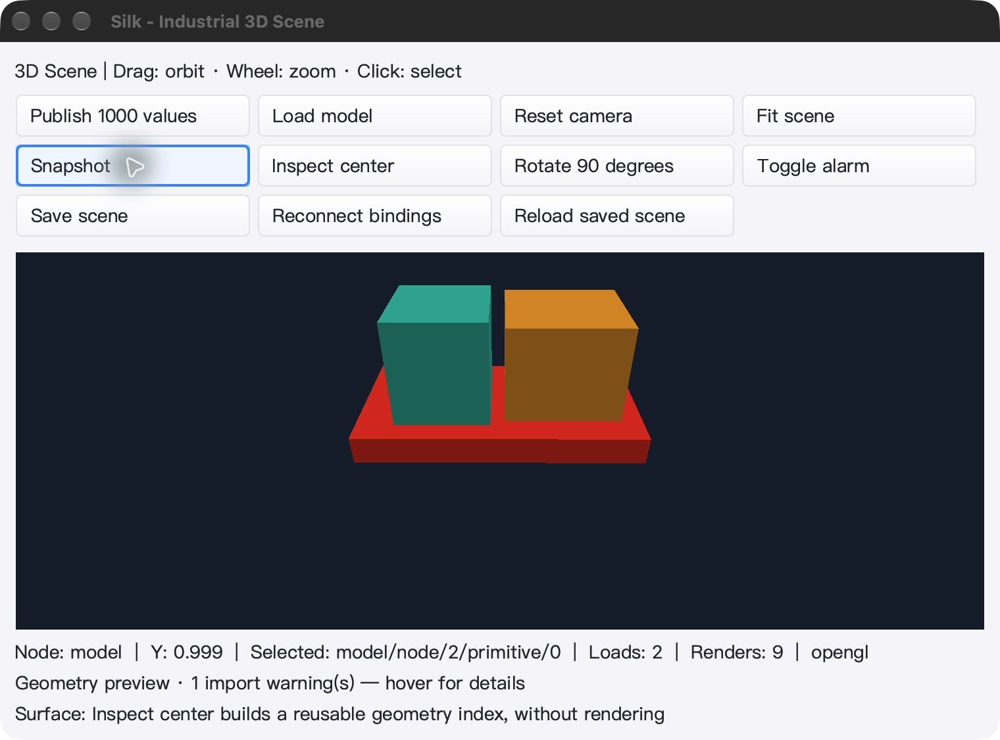
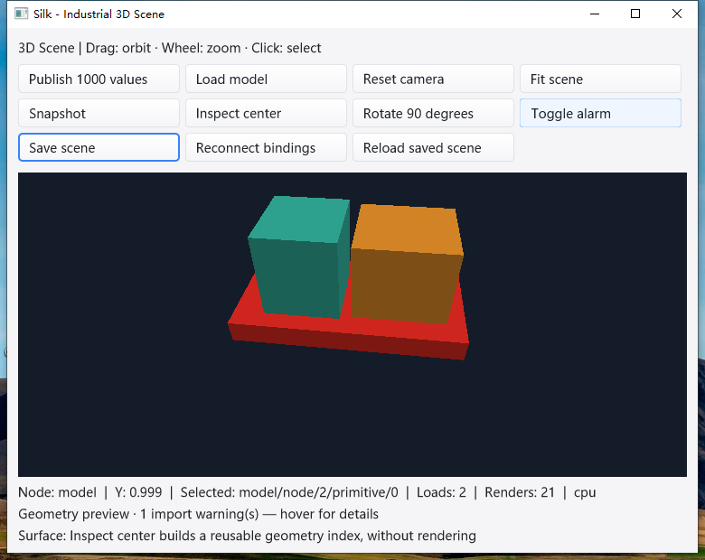

# 实验性有序 GPU 合成验收 — 2026-10-29

## 结论与范围

本增量通过冻结源码三平台全量普通/race、原生渲染与 UI 持久化回读门禁。
新增 **默认关闭** 的 `Window.SetSceneGPUComposition(true)` 与示例 `-gpu-compose`。
它不是工业 IDE 总目标完成，也不是所有窗口零读回或 Windows 硬件 GPU 已验证。

- GLFW 场景直接使用所属窗口上下文；精确单矩形裁剪和按树顺序的不透明 GPU 层，
  配合预乘 Cairo UI 层，保留兄弟遮挡、后绘控件和编辑手柄顺序。
- 曲线、多区或亚像素位置局部退回 Cairo；非 OVER、图标回调、Target 检查与旧帧
  拒绝该次提交并安排完整 Cairo 重试，不展示半成品、不无限重试。
- 窗口销毁前退休 GPU 资源；拒绝工作线程访问；保留原离屏导出/选择性读回路径。
- SDK 新增精确 clip 查询/安全 cutout 辅助函数，不更改 Painter 接口。

## 冻结与自动测试

- 基线：`338878d6255dc3eaec41ee939adf784c09fbd959`；冻结 **2584** 个文件。
- 源码归档 SHA-256：`d37bbf01871e4b71b8549e29c9928b79d390adf02d356a3d0f7473d88611861f`。
- 文件清单 SHA-256：`4867a54e83dedf102f374d4d7fbfe0f31257b2b699be5a251bde99c65d4427f2`。
- Go 1.26.10；普通/race 均 `-count=1 -p 1 ./...`，未以缓存命中代替执行。

| 平台 | 普通：通过 / 跳过 | race：通过 / 跳过 | 测试包通过 |
|---|---:|---:|---:|
| mac | 8577 / 28 | 8577 / 28 | 92 |
| linux | 8516 / 36 | 8516 / 36 | 92 |
| windows | 8329 / 79 | 8329 / 79 | 93 |

跳过项保留在最终 JSON 中；原生/真实 LSP 等 opt-in 验证另行执行，不把 skip 计为通过。
另通过嵌套 map 模块 race、SDK CGO=0、pure-Go 相关包、Linux/Windows amd64/arm64
SDK 构建、SDK/GUI vet、GL 绑定生成字节一致性，以及 60 秒 placement fuzz
（5,833,288 次执行）。macOS/Windows 真实 gopls 5 项及 bundled 3 项 × 3 轮通过。

## 原生像素与生命周期

macOS Apple M2 Max / OpenGL 2.1 Metal 与 Linux Xvfb/Mesa llvmpipe：

- 两个重叠视口及中间/后绘 CPU 层，最终每个 RGBA 通道对照普通 Cairo，最大偏差 1/255；
  包括透明阴影、1 物理像素条纹、PBO 开关、局部失效后的完整重绘和多次 resize。
- 合格视口的直接显示不新增 ColorReads；光栅拾取增加 4 字节 ID，不重新渲染缓存帧。
- 精确 clip、曲线/亚像素回退、算子/图标/Target 拒绝、旧帧、重挂载、Draw 内关闭，
  以及 worker Render/Blit/Close 与 owner 退出竞争通过。
- 原有 GPU 颜色、实例化/BVH、驻留帧、窗口缓冲生命周期回归通过。
- 透明弹窗最终 framebuffer、预乘 alpha、chart 混合及部分纹理上传额外回归通过。
  Linux 初次未启动 X11 compositor，不满足透明弹窗前置条件；在独立测试容器安装并
  启动 xcompmgr 1.1.8 后同一冻结源码复测通过，原始失败日志保留。
- Windows 交互 Session 1：53 个独立测试进程全部通过。
  测试机只提供 OpenGL 1.1，验证的是 GDI/CPU 回退及显式不支持直接合成，不是硬件 GPU。

## 真实 UI 与持久化

macOS 最终完整轮次 PID 50754：加载 assembly.gltf、发布 1000 值、旋转 90°、报警、
保存、重载、重新连接 3 个绑定、真实像素点击、拖拽环绕、紧凑缩窗和正常 Cmd+Q 退出。
先前控制连接中断后的不连续轮次单独归档，不纳入最终验收。

- 最终仍启用直接合成，ColorReads = **0**，ColorBytes = **0**，
  IDReads = **1**，IDBytes = **4**，ColorBlits = **46**。
- 空闲 38.238 秒，进程 CPU 增量 0.170 秒，
  日志无新增，前后光栅化次数一致。不是通用 FPS/吞吐基准；鼠标/按钮采样本身仍会产生 UI blit。
- Windows 同一路径含正常 Alt+F4 退出码 0；空闲 10.028 秒，
  CPU 增量 0.093750 秒，光栅化次数保持不变。
- 两平台各两次保存完全相同：8 节点、2 网格、3 绑定；SDK 独立 LoadDocument/Build/CPU
  render/pick 回读得到 1113 个可见拾取像素，创作根变换仍为单位矩阵。
- 四份保存统一 SHA-256：`de584f405fd7fba89fdc4f866b9ff16fa350f099d47ee2debc1cd39ff8f4024b`。

## 明确限制

首版每个实际重绘采用完整树与整窗 UI 纹理上传；没有新增帧定时器，但小脏区场景不保证
更快。图标回调尚未支持任意算子的隔离，因此会保守退回原路径，不能默认启用到整个 IDE。
尚未实现增量 damage GPU 合成、Windows 直接呈现、纹理/PBR 或真实工业硬件互通。

## 可复核证据

本地：`bin/qa-artifacts/scene-direct-20261029/`；Windows：`C:\silk_scene_direct_20261029`。
重点：`final-verdict.json`、`final-validation.log`、`source-sha256.json`、三平台 full/race
JSONL、`mac-native-final.log`、`linux/native.log`、`mac-alpha.log`、`linux/alpha.log`、
Windows 独立进程结果、两平台 UI verdict、保存文件和 SDK 回读 JSON。

辅助 runner 的就绪竞态、一次同源 Linux 额外重跑及无 compositor 的前置条件失败均留档；
最终门禁只接受真实退出码、完整测试终态、冻结哈希和 UI 回读，不以启动成功替代通过。
