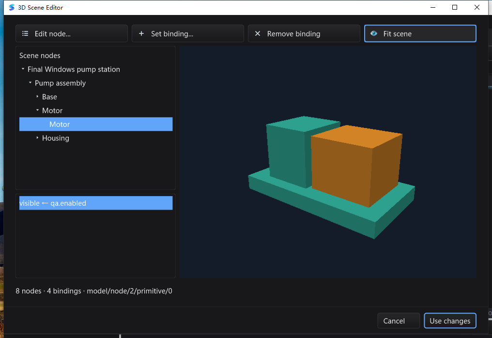

# 场景文档、结构化编辑器与原生模态回归（2026-10-28）

本轮在 `e7d1766` 上增加 `.silkscene` 文档、编译式点位绑定和 SDK / IDE 节点编辑器。
这是工业组态编辑链的增量，不是完整 Qt Creator 对标、PBR 引擎或产品二进制发布。

## 实现与契约

- `scene3d.Document`：静态不透明几何、共享 Mesh、稳定节点、层级、仿射变换、颜色、
  显隐、导入警告及惰性绑定。严格 JSON、32 MiB 输入上限及图/文本/几何预算。
- `SaveDocumentFile`：编码验证后写同目录临时文件，sync/close/rename；失败或取消不截断
  旧文件。拒绝符号链接/目录，不声称掉电持久性、CAS 或所有平台完全相同的 rename 语义。
- `BindingSet`：位置、相对旋转/缩放、可见性和布尔告警颜色；单所有者、单点位批量提交，
  无效样本不部分修改。创作基线导出/原地重绑防止旋转重复叠加。组节点不冒充可继承材质。
- `SceneView`：每个绑定集共用一次合并投递，每 UI 轮最多 256 个样本；取消、关闭、换场景、
  重挂父级均退役旧任务。坏质量保留最后已应用的正常值，不替代无损历史/报警记录。
- `SceneDocumentEditor`：节点树与拾取联动、节点表单、11 种属性绑定、响应式带图标文字按钮。
  修改暂存，取消不提交，提交错误保留窗口。没有隐式 TagDB、网络或现场驱动连接。
- SilkIDE 的 Tools / 命令面板操作先后台有界解码，检查源身份/版本，只产生一次文本缓冲
  替换，复用 Undo/Redo、dirty、Save/Save All、关闭保护、恢复与 JSON 高亮。

## 原生测试发现的真实缺陷及修复

1. macOS V1：嵌套节点窗口 Apply 已修改父场景，但子窗口仍显示且无法响应。
   GLFW 的 native Destroy 为保护 Cocoa 回调而延迟到最外层 MainLoop；嵌套模态不退出时，
   只移除 Go 对象却不 Hide 原生窗口，产生悬空残窗。
2. V2 增加立即 Hide，残窗消失，但 Cocoa 把焦点交给 IDE，父模态退到后面。
   原有焦点恢复也排在最外层销毁队列，必须等父模态退出，形成可见交互缺陷。
3. V3：关闭子模态前，在所有者已重新启用且原生源窗口仍获得焦点时，先恢复父窗口输入；
   再立即 Hide，物理 Destroy 仍延迟。用户已切到别处、新意图、外部逻辑焦点、隐藏/禁用
   父窗不被强制抢焦点。**没有在嵌套回调中强行释放 Cocoa 对象。**

V1/V2 为失败候选，不计为最终通过；V3 不需要通过系统 Window 菜单找回父窗。

额外启用 Linux 原生 backbuffer 探针还发现 X11 时序缺陷：原生 window/framebuffer 已为
330×245，控件根仍是 320×240，首次扩容帧右下角是 `[0 0 0 0]`。修复为每次实际绘制前
按 GLFW 原生逻辑尺寸同步根布局，而不等待滞后的 ConfigureNotify；空闲不增加轮询。
布局中关闭宿主时立即中止绘制，延迟安全退役。探针在每次缩放前故意恢复旧根尺寸，
验证首帧全覆盖，并加入 OnResize 关闭宿主、不再 Draw 的真实原生回归。
随后原生界面又暴露单列节点树沿用通用 Header 的 128 像素默认宽度：面板有空白，
普通节点名称却被截断。改为随当前树视口/滚动条调整列宽，重建模型和拾取展开后仍保持；
完整名称与稳定 ID 可通过提示读取。补充不同宽度及模型重建回归。
最终使用 **V3 冻结源码** 在三平台全部重跑；中途 V2 和旧 Windows 任务明确退役，
其部分结果不作为提交门禁。
增加策略测试与真实 GLFW 退役探针：48 次实际缩放、PBO 开/关、像素回读、Draw 中 Close，
并在销毁队列尚未排空时断言已关闭原生窗口不可见。

## macOS 原生闭环

在隔离 HOME、数据目录及小工程中用 computer use 操作：

- Tools 打开 `assembly.silkscene` → 根节点改名 `Final assembly pump station`、X=0.75 → Apply 直接返回父模态。
- 拾取绿色 Motor → 祖先树展开 → 新增 `model/node/2/primitive/0` 的 `visible ← qa.enabled`。
  下拉菜单关闭后焦点仍在表单，提交直接返回场景编辑器；总计 8 节点 / 4 绑定。
- Use changes → Cmd+S → 文件回读验证名字、矩阵、绑定；单次 Undo + 保存精确恢复原始
  2365 字节；Redo + 保存精确恢复修改版；命令面板重新打开，取消不改变文件，正常退出 0。
- 独立 SceneView V2：加载 → 高度/旋转/告警 → 原地 Reconnect → 保存 → 重载 → 再保存。
  重绑/重载前后目标矩阵完全相同，两次文件 SHA-256 相同且根创作矩阵仍为单位矩阵。
  拾取返回稳定子节点 ID，空闲 Snapshot 不增加渲染次数，正常退出 0。

最终冻结 V3 源码构建的 IDE 二进制 SHA-256：
`c1a4fa5578f9110728e84875e0a0ec1f6aacf6b19d8c47bcb459866865a1bbf1`。
最终原生闭环包含树列宽修复，完整根名称及 `Pump assembly` 均正常显示。修改版文件
SHA-256：`2b3891e5aef53ab65f6c639e744229594a2a2f49d8aef3bade787c2a83952861`。
撤销后的字节与仓库样例一致；重做、命令面板重新打开再取消后仍与该修改版哈希一致。
QA app 未打包外部 icon 目录，stderr 有该路径警告及 macOS 输入法诊断；嵌入图标实际可见。
隔离工程未随 QA app 打包 gopls，本轮截图的 offline 不作为 LSP 验收。

## Windows 原生闭环

Windows 10 交互式 Session 1，最终 V3 二进制 SHA-256：
`bc7d2e93626d281ea1fb27d6a3fdf2673a43c9448c3b1474dc4de5af56282597`。
使用 win10testcomputer 的真实输入/截图，逐次检查前台进程、窗口标题与点击遮挡。

- 从原生 Open 对话框打开隔离工程的 `.silkscene`，状态栏为 JSON。
- Tools 打开场景，根节点改名 `Final Windows pump station`、X=0.75；Apply 自动返回父模态。
- 拾取绿色 Motor，新增 `visible ← qa.enabled`；属性下拉与子表单关闭后均保留正确焦点。
- Fit scene 重新取景，节点树完整显示名称与祖先路径，8 节点 / 4 绑定。
- Use changes 返回文本缓冲并 Ctrl+S；文件回读验证节点、矩阵、绑定。
  修改版 SHA-256：`8fa3f4e79a661034fcecdb5f3fd91ed741262567c6269b7605c3e854cef3cef5`。
  最终原生 stderr 为空。

- 单次 Ctrl+Z + 保存恢复原样例的完整字节；Ctrl+Shift+Z + 保存恢复修改版。
- 命令面板筛选并重新打开该场景，取消后文件哈希保持不变，Alt+F4 正常退出 0。
- 该场景模态空闲采样 10.506 秒，进程累计 CPU 增长 62.5 毫秒（约单核 0.595%）；
  这是一次受控样例观察，不是所有模型、硬件或帧率的性能保证。

## Windows 原生测试的线程前置条件

补跑了 Session 1 下的模态、快捷键、IME 与 WGL race 测试，保留了失败与成功两类证据：

- 背景批跑首先失败在“测试 owner 未取得前台”，尚未进入模态关闭分支。
  前台启动后，同一进程 `-test.count=3` 仍出现前台断言失败，**该批跑不算通过**。
- 只重复一个 foreground 测试并增加独立 `-overlay` 观测（未修改产品/原测试文件）后：
  线程 `10636` 的运行全部激活成功；换到线程 `1036` / `5544` 时，owner 仍可见且启用，
  但 `SetForegroundWindow` 返回 0，原生前台仍属于线程 `11164`。每个 fixture 只单独
  `LockOSThread`，并不能让整个 Go 测试批次共用一个 UI 线程。这不是已复现的模态关闭回归。
- 最终原生验收采用**每个顶层用例独立进程**、同一未插桩 race 二进制、`gui` 包工作目录、
  已实际获得前台的启动器，并读取子进程真实退出码。15 个顶层用例全部通过；三个前台/
  嵌套模态用例各复验 3 次：总计 21 次进程运行、31 条 pass（含子测试）、0 skip、0 fail。
  二进制 SHA-256：`4be7c6ef790e1a234a7633d99cccca6aabf0e99998b1ce4174bfdf8210ff9982`。
- 单进程跨多个原生 UI 线程的批跑不在通过范围，不能把独立进程成功说成该模式已修复。
  真实 IDE 的同一 UI 线程连续节点/绑定/撤销/重新打开工作流，另由上文原生操作链验证。
  没有向产品加入强制抢焦点逻辑，也未改系统 foreground-lock 设置。
  Windows 前台激活有明确的资格约束，见 [Microsoft SetForegroundWindow 文档](https://learn.microsoft.com/en-us/windows/win32/api/winuser/nf-winuser-setforegroundwindow)。

测试启动器还修正过直接运行测试二进制的 cwd 与 PowerShell 退出码采集；不把启动器错误
记作产品通过。证据含 `windows-v3-native-extra/`、`windows-v3-native-final/`、
`native-diagnostic-foreground.log`，诊断与发布源码/二进制分别保存。

## 自动测试矩阵

最终 Go 工具链均为 1.26.10。下表普通/race 均 `-count=1`，退出码全部为 0；
计数包含子测试，skip 不算通过，未把中间失败/退役候选计入最终结果。

| 平台 | 普通全量 | race 全量 | 包结果（每轮） |
| --- | --- | --- | --- |
| macOS / arm64 | 8242 pass / 22 skip | 8242 pass / 22 skip | 91 pass / 19 无测试 |
| Linux / arm64 | 8180 pass / 31 skip | 8180 pass / 31 skip | 91 pass / 19 无测试 |
| Windows / amd64 | 8019 pass / 74 skip | 8019 pass / 74 skip | 92 pass / 18 无测试 |

- 三平台 `mod/map` 独立模块 race 全部通过。
- macOS：额外原生 GL/GUI race、`CGO_ENABLED=0` SDK、`silk_pure_go` 后端全部通过。
- Linux：额外原生 GL/GUI race 通过；48 次缩放、延迟尺寸同步、布局关闭宿主均实际通过。
- Windows：额外原生 race 用例按上述单 UI 线程隔离方式全部通过，包括 IME 与 WGL fallback。
- 六份完整 JSONL 无失败事件或损坏行；四个新增测试文件的顶层 Test 在三平台两轮均实际通过。
- 三平台真实 gopls/dlv 集成因工具不可用跳过，不将 JSON 编辑/场景 UI 当作 LSP 或调试器验收。
  Windows 还缺少 Git/sleep；平台专属测试、显式 QA fixture/原生探针、子进程 helper、字体与
  权限语义的跳过原因均保留在逐条日志。Linux 容器以 root 运行，权限拒绝用例存在跳过；
  Windows 全量运行在 Session 0，真实桌面输入另由上面的 Session 1 操作链验证。
- Windows 结果收集器曾达到自身 45 分钟等待上限，未终止测试；主测试任务随后正常完成。
  已重新核对四份退出码、全部源码哈希并取回原始日志，不把收集超时当作产品通过或失败。

在受控干净源码快照运行 `go test -json -count=1 -timeout=30m -p 1 ./...` 及 `-race`；
主工作区存在不可读的忽略目录，未修改其权限。2468 个受控源码/资源文件逐个 SHA-256
校验；Windows 使用 Python tarfile 制包，拒绝 `._*` AppleDouble 污染，不覆盖旧 QA 目录。
提交工作区与冻结树核对时，2467 文件原始 SHA-256 相同；既有 `core/callback.go.txt`
仅 CRLF/LF 不同，Git clean 后 blob 均为 `1d1c08c3623557d34b18426561799f2bdb4b8de4`，
没有修改该历史文本文件；构建用 Go 源码与资源无差异。
地图独立模块 `mod/map` 单独 race。GUI 布局测试覆盖 320×500、620×520、960×560、1280×720。

- 最终冻结源码重跑：文档 fuzz 45 秒预算，4,448,451 次执行，PASS；
  glTF fuzz 30 秒预算，790,069 次执行，PASS。
- Apple M2 Max、单 tag 扇出 1000 节点：105408–106886 ns/op，0 B/op、0 allocs/op。
  这是绑定变换更新，不是整帧渲染或 GPU FPS。
- `go vet ./scene3d/...` 与变更包 `go vet -composites=false` 通过。
  全仓库 `go vet -composites=false ./...` 仍报告已存在的 `i18n/i18n_test.go` 拷贝 RWMutex，
  默认 vet 还含既有 GUI/ged unkeyed literal 提示；不能称完整默认 vet 干净。

## 边界与复现资料

- `.silkscene` 是当前引擎静态几何快照，不是 glTF/PBR 的无损原件；无节点增删、gizmo、
  完整 TRS 表单、纹理/动画/蒙皮、GPU 实例化、直接 GPU 合成或现场驱动配置。
- UI 对象严格单 UI 线程；正常样本合并可丢弃中间状态。局部变换成功不保证世界层级不会
  溢出，最终由 `Scene.Snapshot` 拒绝。阻塞 Reader/Writer 的中断由调用者负责。
- Linux Xvfb/Mesa 为软件 GL，不是物理桌面或硬件 GPU；Windows 本机 OpenGL 1.1 只能验证
  明确的 CPU fallback，不能冒充 Windows 硬件 GPU 通过。
- 可重跑入口：`go run ./examples/scene3d -model examples/scene3d/assembly.gltf -scene-output /tmp/plant.silkscene`；
  IDE 打开仓库自有 `examples/scene3d/assembly.silkscene` 后用 Tools → Edit 3D Scene...。
- 本地完整证据：`bin/qa-artifacts/scene-document-20261028/`。含冻结 manifest、平台逐条 JSONL、
  exit 文件、源码校验、fuzz/benchmark、原生 stdout/stderr、保存文件及断言 JSON。
  测试制品保留本地，不把二进制/临时数据提交仓库。
