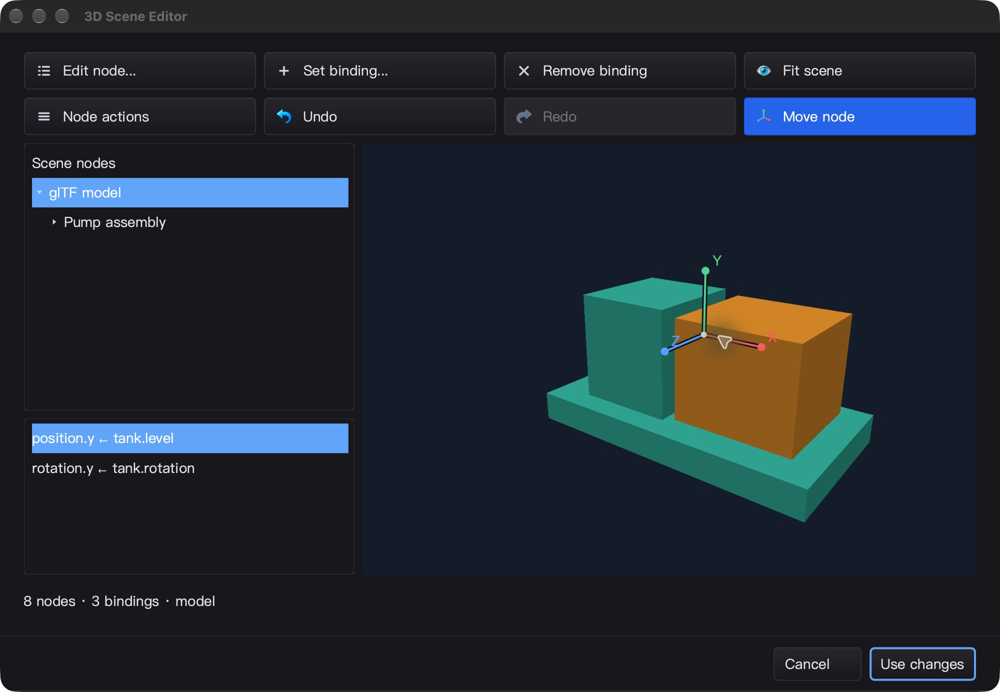
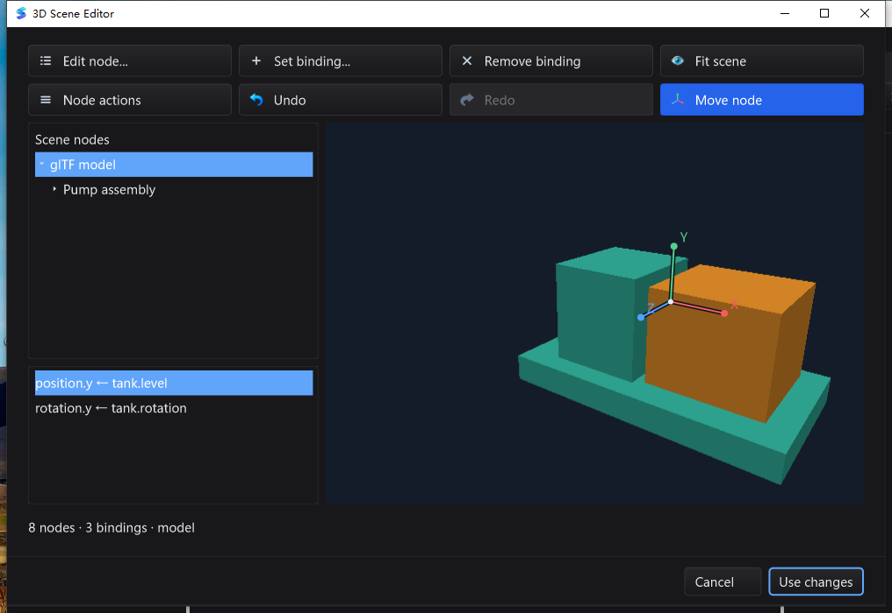

# 场景平移工具与输入取消验收 — 2026-10-29

基线：`208fb070ce20b43627b217897d896d8b623d3a32`。
最终结论：**本轮冻结源码的完整门禁通过（`FINAL_GATE_PASS`）**。三平台普通/race、
原生补充、真实/随包 gopls、UI 持久化、源码与产物一致性均已核验。以下明确区分通过范围与未验证项。

## 实现范围

- SDK 相机投影/世界射线、前向射线平面交点、不可变轴向拖拽求解器。
  位移从初始抓取点计算，不累计舍入漂移；支持世界位移网格吸附。
- `EditSession.BeginTranslation` 捕获 revision 和父级逆线性基；预览不修改文档、绑定或历史。
  保持旋转/缩放/镜像/剪切，拒绝奇异父级，支持组和隐藏节点。
  Commit 完整验证并只追加一次历史；无变化保留原矩阵编码/redo；过期手势拒绝覆盖新编辑。
- 场景编辑器 **Move node**、矢量 XYZ 图标/手柄、Shift 一单位吸附；未命中手柄仍可旋转/拾取。
  全部绘制在既有画布裁剪内，无新原生子窗口、常驻帧定时器或悬空覆盖层。
- UI 的 Escape 优先取消当前拖动，再次 Escape 才按既有逻辑取消对话框；原 popup 优先级不变。
  捕获转移、原生失焦/失捕获、禁用、隐藏、尺寸/相机/场景变化取消未提交的预览。
  `IEventPointerCancel` 是 UI 线程上的可选接口，不意味着所有控件已迁移。

## 自动化测试覆盖

- 相机投影/射线互逆、视口缩放、无效/非有限/极值输入、前向/平行交点；随机相机 roundtrip fuzz。
- 不同父级旋转/非均匀缩放/剪切/反射、隐藏节点、奇异基、巨大平移、零位移、取消、过期 revision、
  精确 undo/redo；预览过程中权威文档/绑定不变。
- 连续 20 个移动事件只产生一次历史；13 种取消路径、失焦 owner 隔离、过期 release。
  1 / 1.5 / 2 倍渲染缩放与裁剪外像素不变、静止重绘缓存、图标 16–96 像素 XYZ 颜色覆盖。
- 新增交互的 14 项顶层测试另做 **20 轮 race 回归**，全部通过。
- 最终冻结候选的 macOS 普通/race 各 8415 pass / 25 skip；Linux arm64 普通/race 各 8354 pass / 33 skip，
  两者均 92 个有测试包通过、19 个无测试包；没有把 skip/无测试包计作测试通过。
- macOS 原生 GPU、Linux Xvfb/Mesa 软件 GL 的 21 组 BVH / 90 组实例化 RGBA 与拾取 ID
  精确对照、context 所有权、1000 实例单 draw、控件缓存与生命周期通过。
- 无 CGO/pure Go、SDK vet、GUI/IDE vet（`-composites=false`）、地图子模块 race 通过。
  macOS 与 Windows 分别完成真实 gopls 5 项 race、相邻 bundled gopls 3 项 × 3 轮，无 skip。
- Windows Session 1 的 **36 个独立原生进程 / 30 个不同用例** 全部通过，覆盖新增六项场景
  交互、场景文档、缓存、WGL CPU 回退和模态窗口直接 owner/独立前景保护。
- 第一候选 Windows 普通全量：8191 pass / 77 skip / 1 fail；唯一失败为
  `TestIntegerRangeGeneratedSDKRuntime`，不是新增场景交互用例。原 race 在测试源码修正后
  被停止，不算通过。新冻结树的三平台完整测试全部重跑，不能沿用前一候选成绩发布。
  最终 macOS/Linux 两次全量均包含分阶段 race 编译和实际生成代码断言 PASS 标记。
  最终 Windows 普通/race 各 8192 pass / 77 skip，93 个有测试包、18 个无测试包。

## macOS 实际 UI 和磁盘闭环

隔离 HOME/APPDATA/workspace；8 节点、2 共享 mesh、3 个惰性绑定的 assembly 夹具。
实际 Tools → Edit 3D Scene → Move node → X 手柄拖拽 → Undo → Redo → Use changes → Save。

- 文件只改变 `model.transform[12]`：`0 → 0.4321730197297492`；Y/Z 为 0，其他矩阵分量、
  节点、网格和绑定不变。宿主 Undo/Save 与原文件字节相同，Redo/Save 与移动后文件字节相同。
- 重开场景并打开节点表单，显示的 X/Y/Z 与文件回读一致；取消后文件未再改变。
- 测试 PID 68770，正常 Cmd+Q 退出 0。二进制 SHA-256：
  `d9979436249a5f7263b79f8d67c7008782bc5060ba5555dcd5749708f35cd2c7`。
  UI 构建与最终冻结树的生产 Go 文件逐一一致；构建后仅补充了测试。
- **未确认**：嵌套节点 Cancel 后，CUA 再次选到主窗；Window 菜单可恢复仍存在的场景。
  不将自动归还直接 owner 焦点算作通过；与上一轮现象相同，本轮没有宣称修复。
  macOS 拖动中 Escape 由单元测试覆盖，未通过 CUA 驱动按住鼠标期间的取消。



## Windows 实际 UI 和磁盘闭环

同一最终冻结源码、隔离 workspace 和应用数据，Session 1 的原生窗口；仅操作属于测试 PID 的窗口，
每次点击检查 foreground/像素窗口 owner。使用与 macOS 相同的 8 节点、2 mesh、3 惰性绑定夹具。

- 按住鼠标拖动 X 手柄时，Escape 取消但不关闭场景；另一次拖动通过独立 QA 窗口取得真实原生焦点。
  两种预览的模型区域均实际改变 25,655 像素；取消后视口像素与初始逐一相同，保存文件字节不变。
- 实际 Shift 拖动把世界 X 吸附到 **1**，Y/Z 为 0；仅 `model.transform[12]` 改变，其他节点、网格、
  矩阵分量与绑定完全不变。场景 Undo/Redo 的视口分别与原始/移动后像素一致。
- 宿主 Ctrl+Z/Ctrl+S 恢复原始字节，Ctrl+Y/Ctrl+S 恢复移动后字节。重新打开节点表单显示 X=1、Y=0、Z=0。
- 节点 Cancel 当场返回直接场景 owner，文件无变化。Windows 此路径通过不代表 macOS 已通过同一焦点检查。
- 真实 UI 在全量编译期间提前完成交互；最终门禁必须验证提前构建与全量后 IDE 的二进制 SHA 完全相同，
  不一致则必须重测最终产物。测试 PID 10868 正常 Alt+F4 退出 0，stderr 为空；
  提前 UI 二进制 SHA-256 为 `7ec499dabbc1fc14abfda3846e759b4e1317805f1d319767812b3343bbf2a984`。
  全量后构建的 IDE 与提前 UI 测试产物 SHA 完全相同，核验日志为
  `EARLY_UI_SAME_BINARY_ALREADY_VERIFIED`；未用源码相同替代 Windows 产物字节相同。



## 性能范围

Apple M2 Max，`BenchmarkTranslationEditPreview10000` 三次 300 ms：
**19.22 / 21.17 / 20.39 ns/op，0 B/op，0 allocs/op**。
这是已有 10000 节点 session 上的 `TranslationEdit.Transform` 矩阵预览计算，
**不是鼠标事件到显示的延迟或渲染 FPS**。开始手势需查询节点/父级；提交需完整文档验证；
应用预览、生成快照、渲染和 GPU readback 仍有各自成本。

最终冻结候选的 `FuzzCameraProjectionRoundTrip` 60 秒运行 **3,741,390 次**，无失败。
第一候选 60 秒 4,229,881 次和早期 30 秒 2,455,951 次作为历史记录保留，不代替最终候选。

Windows 场景静止的一次 10.017 秒采样，进程 CPU 累计 0.078125 秒、末次 RSS 32,804,864 字节，
窗口保持响应；只代表该夹具的一次短采样，不是持续负载、FPS 或全应用性能保证。

## 复跑与证据

新候选 `bin/qa-artifacts/scene-gizmo-final-20261029/` 保存独立干净 `src/`、源码归档/哈希、原始测试事件、
独立退出码、截图和文件回读。没有删除或更改用户工作区历史 Package/local 目录权限。
最终 Windows 证据归档 200 个文件，SHA-256：
`51554c77baae5d5bb308e8a7c60fd427caaada5850a782da939566aef0ea9587`。
原始失败记录保留，不把失败重写成成功；最终校验另检查失败原因、修正后的通过和源码未变化。
冻结快照 2521 文件，树 `a0b9a2bcfd445752a2ae272e27f024de585f75f8`；归档 SHA-256：
`0313e152ca9acaa95ce5aa982f8d51a3cbc7d85904568f114e9c81dad852d4cb`。

```sh
# 冻结的干净源码目录；原生用例另需平台桌面/GL。
go test -json -count=1 -timeout=30m -p 1 ./...
go test -json -race -count=1 -timeout=30m -p 1 ./...
go test -race -count=1 ./scene3d/...
go test -run '^$' -fuzz '^FuzzCameraProjectionRoundTrip$' -fuzztime=60s -parallel=4 ./scene3d
CGO_ENABLED=0 go test -count=1 ./scene3d/...
go test -tags silk_pure_go -count=1 -p 1 ./paint ./gui ./ged ./decl ./scene3d/...
(cd mod/map && go test -race -count=1 ./...)
```

早期测试的未使用 import 与假窗口尺寸夹具失败日志保留；修正测试设置后定向测试通过，
没有把原 exit 1 改为 0。QA 冻结脚本首次过早启动 runner，由 Docker 自动创建空目录触发
FileExistsError，另两个 runner 缺少尚未生成的脚本；失败留存在 `*-setup-attempt1.*`。
完成冻结/哈希验证后才启动最终三平台 runner，不将打包顺序问题描述为产品修复。

## Windows 生成 SDK 测试的编译/执行预算

第一候选的 `TestIntegerRangeGeneratedSDKRuntime` 在 121.18 秒失败，旧代码把整个
`go test -race`（包含编译）放在 120 秒 context 内，日志没有记录 context 状态，只有
`exit status 1`。**原次退出是否正由 deadline 触发，没有直接栈/上下文证据**。

独立解包副本只增加 `-x` 与 context 诊断，保留同样的 120 秒期限：107.82 秒通过，日志
包含 Cairo/GL cgo、GUI race 编译与链接；实际生成代码断言仅 0.02 秒。上一轮相同用例
耗时 94.34 秒。这个对照证明编译在预算中占主导，不能把重跑通过当成原失败已自动消失。

本轮只修正测试适配器 `ged/integer_range_test.go`，不更改 SpinBox/生成器生产逻辑：
- 独立的 race 编译阶段限 5 分钟，并记录耗时、错误和 context 状态。
- 已编译的测试二进制限 30 秒，内部 `-test.timeout=25s` 留出打印栈的时间；运行预算比原来更紧。
- 检查必需的 `TestIntegerGeneratedRuntime` PASS 标记；不能以“没运行断言但退出 0”蒙混通过。
- 子进程使用独立临时 `SILK_DATA_DIR`，保留 GOMAXPROCS=2 与 race，管道等待限制为 5 秒。
- macOS 分阶段版本三次定向 race 已通过；最后的子进程数据隔离也进入新的完整冻结树。
- 最终 Windows 普通全量中该用例耗时 122.18 秒并通过，race 编译耗时 115.797 秒，
  实际断言 0.02 秒；全量 race 中分别为总计 27.02 秒、编译 20.086 秒、断言 0.02 秒。
  新日志明确分离了编译与运行成本，没有绕过断言或去掉 race。

第一候选的失败 JSON、独立诊断日志、停止原因与退出码保留在
`bin/qa-artifacts/scene-gizmo-20261029/` 和其 Windows 对应目录；未覆盖成成功。
最终 `validate-final.py` 已返回 `FINAL_GATE_PASS`，结果写入 `final-verdict.json`。
源码改动全部在冻结前完成；之后只补充文档、截图和 QA 夹具/校验脚本，未修改生产或测试源码。

## Windows 随包 gopls 的 QA 夹具遗漏

最终源码的 Windows 普通/race、5 项真实 gopls 已通过后，随包 LSP 第一轮的三项测试全部被
`gopls license missing from bundle` 拦截。本次临时 QA 脚本只复制 `tools` 的普通文件，
漏掉 `licenses` 子树；不是 gopls 二进制缺失，也没有放宽产品完整性校验。

- 已核查 `.github/workflows/windows-runtime.yml`、`release.yml` 与实际打包脚本：生产流程递归
  复制工具目录，并运行 `cmd/silktools -verify`；本次没有修改产品打包或 LSP 代码。
- 原始 `runner.exit.attempt1`、`bundled-1.*.attempt1` 以及本地 wrapper 失败记录保留。
- 只补齐上一轮已验证 bundle 的许可证夹具，两个工具位置逐文件比对 SHA；gopls、IDE 和测试
  二进制不变，冻结源码 2521 文件再次核验。随后要求真实 bundle verifier 两处通过、
  三项随包测试连续三轮无 skip，均已通过；原生、二进制核对与最终归档门禁也通过。
  两个位置共复制并核对同一组 26 份许可证文件。
- 冻结源码上的文件系统打包回归已通过，覆盖 macOS 许可证复制/资源、Windows ICO/编译器
  失败处理、Linux desktop 引号路径；这是合成打包夹具测试，不替代真实 gopls 运行。

## 未实现/未验证范围

仅单节点/组的世界 XYZ 平移；尚无旋转/缩放手柄、多选、局部坐标模式或设备库拖入。
Windows 测试机原有 OpenGL 1.1 驱动只支持 CPU 回退；Linux 为 arm64 Xvfb/Mesa 软件 GL，
都不能当成 Windows 硬件 GPU 或 Linux 物理桌面验收。绑定夹具没有连接真实工业设备。
PBR/纹理/动画、GPU 直接合成、全应用性能指标与完整 Qt Creator 对等目标仍未完成。
