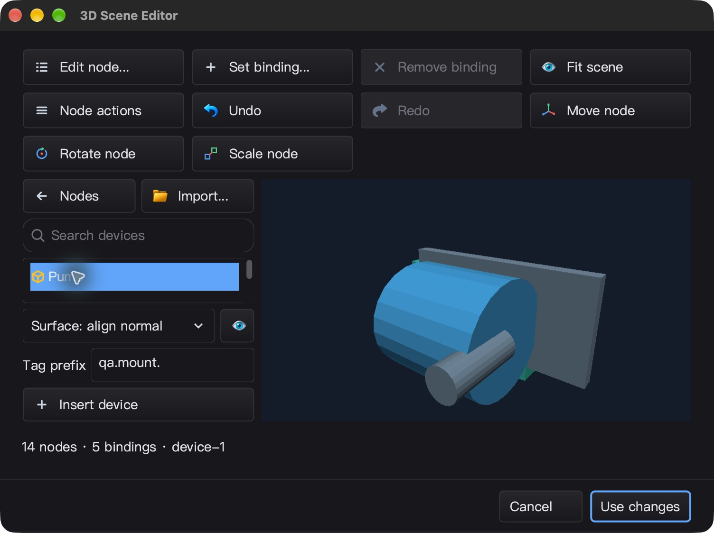
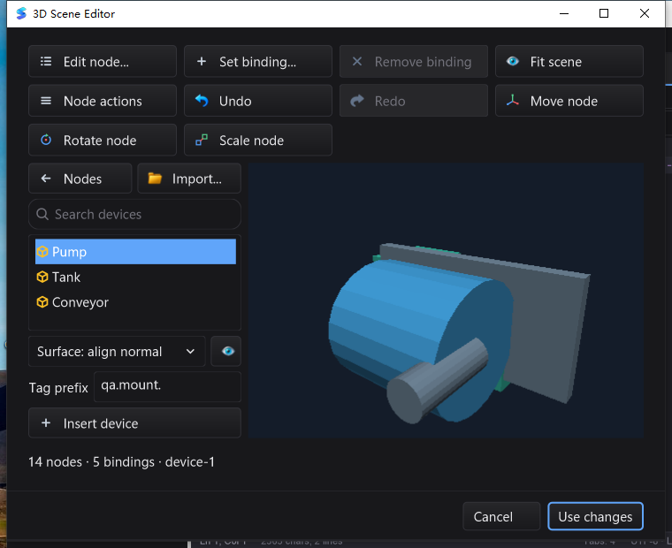

# 模型表面放置与紧凑设备库验收 — 2026-10-29

本增量基于 `3667367`，最终机器判定 **`FINAL_GATE_PASS`**。本报告是冻结前
路线图“开发与验收进行中”条目的最终验收记录；整体工业 IDE / Qt Creator 对标目标仍在推进。

## 实现

- SDK 新增 `Template.Bounds()` / `BaseAnchor()`，预编译可见几何边界与底部中心，查询 O(1)。
- `SurfacePlacementTransform` 为无分配纯矩阵求解器：支持保持竖直、+Y 对齐法线、局部朝向和法线偏移；
  检查非有限输入、零法线、溢出及极小/极大法线，返回世界矩阵。指定父级时调用者须转换成父级局部矩阵。
- 设备库新增地平面、表面竖直、法线对齐三种模式；UI 线程捕获快照、后台可取消构建/refit。
  请求代数和快照身份隔离旧完成；模式与模型导入使用独立代数，避免切换模式使并发导入永久 busy。
- hover/Draw/idle 不建树、不轮询。拖动只更新内嵌裁剪标记；落下沿用 EditSession 单事务合并节点、
  资源、惰性绑定与历史。索引过期、未准备或未命中都拒绝放置，绝不悄悄退回地面。
- 实际缩窗发现旧 760px 工具栏阈值导致行数突增、设备列表被挤扁：改为测量标题计算列数，
  小高度设备库合并辅助行，保留可滚动列表、模式、重试、点位前缀和插入，完整提示保留在 tooltip。

## 完整测试

同一份冻结源码，所有运行使用 `-count=1`，不以 `(cached)` 作为证据。

| 平台 | 普通通过 | race 通过 | 每轮条件跳过 | 有测试的包 |
|---|---:|---:|---:|---:|
| macOS arm64 | 8,550 | 8,550 | 25 | 92 |
| Linux arm64 / Xvfb + Mesa | 8,489 | 8,489 | 33 | 92 |
| Windows 10 amd64 | 8,317 | 8,317 | 77 | 93 |

通过数包含子测试/fuzz 种子；没有测试文件的包不计入该列。平台/环境条件跳过明细保存在最终 JSON；
不是零跳过，也不代表未配置的现场硬件、协议服务器或所有平台专属能力已验证。

完整命令：`go test -json [-race] -count=1 -timeout=30m -p 1 ./...`。
另外通过：

- 独立模块 `mod/map` 三平台 race；`tools/gopls-module` 是工具依赖清单，没有自有源码测试。
- 新放置/布局测试 20 轮 race；SDK 全包 race；`FuzzSurfacePlacementFrames` 60 秒，
  **6,797,281 次执行**；随机帧、极值、零分配、取消、并发导入、过期拖动、精确历史与绑定保护。
- macOS / Windows 真实 gopls 5 项，随包路径 3 项 × 3 轮，均无跳过；工具包校验通过。
- macOS / Linux 原生 GL：90 组实例化 RGBA/拾取一致性、21 组 BVH 一致性，窗口 resize/backbuffer 生命周期。
- Windows 交互式桌面 **50 个独立进程 / 44 个用例**，包括新增 5 个表面放置用例、WGL/CPU fallback、
  IME、模态焦点与所有权、菜单/线程调度；前台恢复的三个用例分别运行三轮。
- 三平台 `CGO_ENABLED=0` SDK 运行；`silk_pure_go` GUI/设计器相关测试；SDK/GUI/IDE vet；
  Windows amd64、Linux amd64/arm64 的纯 Go SDK 交叉编译；完整 IDE 与示例构建。

## 真实 UI 与持久化

### macOS

CUA 操作真实 IDE，缩至 1504×1124 Retina 像素的窗口，菜单打开设备库 → 法线对齐 → 设置
`qa.mount.` → 拖到空白处仍为 8 节点/3 绑定 → 拖到橙色模型正面成为 14 节点/5 绑定 →
场景 Undo/Redo → Use changes/保存 → 宿主 Undo/Redo。

文件回读验证宿主撤销与原文逐字节相同、重做与保存结果逐字节相同；SDK 独立射线从保存的安装
锚点反查原始模型，命中 `model/node/3/primitive/0` 第 2 个三角，世界 z=0.55、法线 +Z。
原有节点/绑定未变，`qa.mount.angle` 更新不会挪动安装框架。

UI 二进制 SHA-256：`7a87db3a545366fd0f488158c9d3cb54bbcc2cfe4170652204025bcf28aa8fbd`。
本次 UI 对应的 1,881 个 Go 源文件与最终冻结源码一致；UI 构建目录和全量构建目录不同，不声称
两个 macOS 二进制字节相同。Cmd+Q 后 PID 消失；LaunchServices 未提供退出码，不声称 exit=0。

### Windows

通过 win10testcomputer skill 在 Session 1 驱动生产 IDE，而非 SSH Session 0 合成 UI。
760×620 小窗口中完成相同空白拒绝/原生 OLE 表面拖放/场景历史/保存闭环；宿主 Undo/Redo 字节
一致，重新打开显示 14 节点、4 网格、5 绑定。独立射线同样证实安装锚点在原始模型 z=0.55 表面，
绑定保持安装矩阵不变。Cancel 不改文件，Alt+F4 正常退出，进程句柄取得 **exit=0**。

实际 UI 与完整矩阵后的最终 IDE 二进制完全相同：
`08b1781c9943b4488a1490722ec0df3b1a8d273704ee01b7fd6889eb40c3686b`。

## 性能和能力边界

- 单次空闲采样：macOS IDE 10.005 秒消耗 0.126123 CPU 秒；
  Windows IDE 10.151 秒消耗 0.046875 CPU 秒，持续响应。
  这是单进程样本，不包含语言服务子进程，也不是整机、持续负载或绘制次数保证。
- 131,072 三角网格固定射线微基准保持 0 B/op、0 allocs/op；本轮 M2 Max 约 2.346–2.363 µs/op。
  不能据此宣称整应用 FPS、建树性能或复杂场景吞吐。20ms 查询取消是协作式预算，不是硬实时截止。
- 底部锚点采用**保守可见 AABB**，不是几何碰撞、CAD 安装面识别或持久附着约束；之后移动目标
  不会自动移动已放置设备。背面法线遵循网格绕序，不自动朝向相机。
- Windows 实际视口为 CPU fallback；Linux 为 Xvfb/Mesa；不代表 Windows 硬件 GPU 或现场设备互通。
  极端小于可用控件尺寸的宿主仍只能做边界裁剪，未声称任意 1px 窗口均可操作。

## 过程修正与证据

- macOS 首版实际缩窗暴露工具栏阈值/列表挤压，修正后用 v2 UI 重测，并以最终源码重跑完整三平台。
  首版 QA App 漏复制随包 tools 是测试包装问题；v2 使用校验后的 tools，产品 resolver 未变。
- Windows 调度脚本数字替换误改了 SSH key 文件名，传输前失败，已保留并修正；随后早期 UI 与完整
  runner 同时覆盖已加载 DLL 被 Windows 拒绝。改为已有依赖先校验 SHA、只复制缺失项，在完整
  普通测试尚未开始前重启 runner。未改产品、未放宽断言、未复用失败轮结果。
- 菜单自动化首轮沿用旧工具栏坐标未打开设备库；根据实际截图改为当前 Node actions 坐标后重做。
  最终 native 结果由保存回读、独立射线、进程退出和完整门禁判定，不以脚本的单步提示作通过依据。

冻结文件 **2,558**，基线 `3667367dabef5ef9c9fe1936b8962ce55f37690d`；源码归档：
`2945ea58a6d9875de81e17458f9d834c4de7c03aa8eb358fad52436f99888eac`。

Windows 最终证据包：`95fd1617f5aa5d09fb94a5d33d8ff7cada1ba4422fa7e2a389044e31ad5219cc`。

`bin/qa-artifacts/placement-final-20261029/` 保存冻结清单、逐包 JSON、跳过原因、前后哈希、
真实 UI 文件/截图/退出证据、50 个原生进程身份、语言服务记录和 `final-verdict.json`。
原始开发及 macOS v1/v2 证据在 `bin/qa-artifacts/surface-placement-20261029/`，不提交大型运行产物。
本报告与两张截图在门禁通过后生成，不改变已测试的实现。
