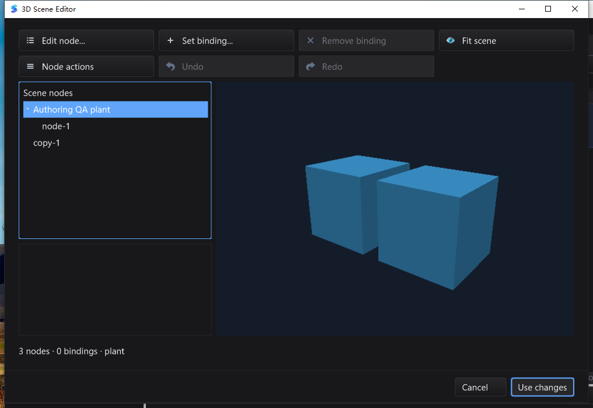

# 场景 SDK / 编辑器最终验收 — 2026-10-28

基线 `493136ebd086bc0e02f810a0a047c70d5afb6774`。本轮合并设备模板、保守视锥裁剪、
有序 GPU 实例化和事务式场景编辑器；这是可提交的功能迭代，不是完整 Qt Creator/工业
组态目标完成，也不创建新的 release/tag 或发布安装包。

## 同一源码与完整测试

最终候选：`scene-authoring-v2-20261028`，2500 个源码/资源文件逐项 SHA-256 校验。
三平台构建和测试使用同一冻结清单；回读前后源码不变。严格汇总器结果为
`PASS_WITH_DOCUMENTED_SKIPS`，41 个新增/场景顶层测试在三平台普通与 race 中均通过。主工作区整合只允许文档更新，
运行时代码与测试文件必须与已验收候选完全一致；既有 CRLF 文件另按 Git 原始 blob 核对。

| 平台 | 普通全量 | race 全量 | 包通过 / 无测试 |
| --- | --- | --- | --- |
| macOS arm64 | 8361 pass / 24 skip | 8361 pass / 24 skip | 92 / 19 |
| Linux arm64 | 8300 pass / 32 skip | 8300 pass / 32 skip | 92 / 19 |
| Windows amd64 | 8138 pass / 76 skip | 8138 pass / 76 skip | 93 / 18 |

Linux 架构勘误（2026-10-29）：原表误写 amd64，实际 `linux/go-version.txt` 为
`go version go1.26.10 linux/arm64`，测试镜像检查同为 arm64；计数与原测试结果不变，
不据此声称 Linux amd64 已验收。

计数包含子测试与 fuzz seed。所有全量均 `-count=1`，不用缓存结果，单独核对退出码、
JSON 终态、失败/race 标记与新增测试名称。未把 skip、无测试包或编译成功算作通过。
完整跳过名保存在最终 `final-validation.json`；平台专属、可选 native/LSP、调试器和
QA 夹具门禁仍按各自要求处理，不宣称每个可选硬件/工具组合都得到验证。

整合后的暂存区代码树另建干净 worktree，再执行完整普通 / race 两轮，均为
8361 pass / 24 skip、92 个包通过 / 19 个无测试包，退出码均为 0。测试后运行时代码
和测试文件不再改变，仅把这段结果与工作区诊断补入本报告。

额外门禁：

- 三平台 `mod/map` 独立模块 race；macOS/Windows `CGO_ENABLED=0` 场景 SDK；
  macOS `silk_pure_go` 的 paint/gui/ged/decl/scene3d。
- macOS 和 Linux 严格 native race：90 组完整 RGBA / ID 字节相等对照、裁剪/回入、
  错误线程/context、两 context 并行及关闭；真实 SceneView 1000 实例只发出 1 draw。
  Linux 另覆盖 GLSL 1.30 变体；Apple 使用 EXT flat-varying 变体。
- macOS 和 Windows 实际 gopls 服务集成 5 项、相邻 tools 目录的随包 gopls 3 项，
  均要求 0 skip。覆盖未保存 Unicode 文档的补全、格式化、跳转和重命名；不等同
  已验收所有原生 LSP 弹窗或重发四平台安装包。
- Windows Session 1 原生 race：22 个顶层用例、28 个独立进程，含子测试与重复轮次
  共 38 pass / 0 skip；焦点、嵌套模态、IME、快捷键、WGL 回退和新作者会话操作均通过。
- 最终作者会话 fuzz 45 秒、53634 次执行；生成器重放的 `bindings.go`、`bindings.h`、
  `load.inc` 与冻结文件逐字节相同；差异/格式检查通过。
- `go vet` 范围为 scene3d 和 mod/map；GUI/IDE 使用 `-composites=false`。
  不宣称全仓库默认 vet 告警已清零。

## 真实 UI 与文件闭环

macOS 在独立配置/工作目录运行最终 IDE 二进制，由原生 CUA 操作：

1. 打开 67 字节的 group-only 基线；Fit scene 禁用。
2. 新增 Box 后可取景；隐藏父节点后预览为空且 Fit 禁用；Undo 恢复。
3. 复制子树（默认偏移 2.5、默认不复制绑定），保持世界变换改为根节点。
4. 删除默认焦点为 Cancel，点击取消无改变；确认删除后 Undo/Redo 恢复/删除正确。
5. Use changes 只更新编辑缓冲，磁盘保持原始字节；Save 后回读为 3 节点、1 共享
   mesh、0 绑定，副本仍位于 X=2.5。
6. 单次宿主 Undo + Save 精确恢复 67 字节基线；Redo + Save 精确恢复 1848 字节
   修改版；重新打开看见两个 Box 和正确层级，Cancel 不改文件，正常退出 0。

第一轮自动输入因命令面板未确认打开而污染 IME 文本，已弃用并单独保存；最终上述
验收从干净目录重做。一次子窗关闭后的前台切换通过原生 Window 菜单恢复已有场景窗，
没有丢失状态。CUA 的单次 Return 未成功关闭删除确认，故该动作不作为键盘通过证据；
取消使用可见按钮确认，原生键盘行为另由专门测试覆盖。

Windows 最终版在交互式 Session 1、独立配置/工作目录验证上述新增 Box、复制、保持
世界变换改父级、删除取消/确认、场景 Undo/Redo、Use changes、Save、宿主单步
Undo/Redo、重开与 Cancel。删除对话框默认焦点在 Cancel，Return 确实取消；
67 / 1848 字节文件与 macOS 验收结果逐字节一致。随包 gopls 启动并完成 workspace
加载；源码在 UI 关闭后再次核对 2500 文件，二进制哈希不变，正常 Alt+F4 退出 0。
一次 10024.57 ms 的静置采样累计 CPU 62.5 ms（约单核 0.62%）；这只是该场景的
单次样本，不当作全部编辑器场景的性能保证。




早期 25 设备/75 绑定模板原生工作流与截图见
[模板阶段记录](SCENE_TEMPLATE_QA_20261028.md)。它们单独保留候选哈希，不冒充最终
作者会话二进制的 UI 截图。

## 失败、修复与证据边界

- 真实 authoring UI 发现 group-only 场景仍能 Fit，先保留失败测试，再以缓存 Snapshot
  的可见实例数量修正按钮状态；不新增布局扫描、后台轮询或定时器。
- Linux 实例化随机场景曾出现 2 个颜色字节的 1 LSB 偏差；改 flat varying 后严格
  字节对照通过，没有放宽容差或拾取 ID 检查。
- Windows 随包 gopls 的首次运行与原条件复测均在 Unicode 补全 8 秒超时。外部 overlay
  只增加 RPC 日志，生产源码/验收二进制不改；日志确认直接启动测试 EXE 的脚本把系统
  Go 1.26.5 放在 PATH 前面，而正常 `go test` 使用模块要求的 Go 1.26.10。只将测试
  进程 PATH 切到同一 Go 1.26.10，日志中的实际 workspace toolchain 同步改变，诊断
  用例 2.43 秒通过。最终仍用原测试二进制、原 8 秒断言，额外连续三轮各 3 项验证；
  原失败/诊断/复测日志全部保留，不称修复了 gopls 源码，也不修改系统 PATH 或杀软。
- 原主工作区的额外复跑确实失败：Go 扫入 `.gitignore` 已排除的历史 `Package/dc`
  副本（`dc/core` 等旧导入路径不存在），并遇到忽略目录 `bin/local` 的访问错误。
  这些不是暂存/提交代码；未删除、改权限或提交这些文件。失败日志完整保留，最终以
  `git write-tree` 的精确暂存树建立新 worktree，重新跑全部普通/race，不靠过滤失败包。
- 原模板 SSH 收集 wrapper 曾断开，旧 authoring Windows 候选因已知 Fit 问题被明确
  取消，其退出 1/255 均不记通过；最终候选完整重跑，不拼接旧候选测试结果。
- Windows 测试机只暴露 legacy OpenGL，验收的是原生 CPU fallback，不是 Windows
  硬件实例化。Linux 是 Xvfb/Mesa llvmpipe，不是物理显示器或硬件 GPU 性能。
- Apple 的窄场景实例化样本更快，但 Linux 软件 GL 的对应样本并未更快；draw 减少
  不等同所有驱动 FPS 提升。当前仍同步 readback 到 Cairo，不保证全应用空闲/高负载指标。
- PBR/纹理、gizmo、设备库拖入、BVH/LOD、直接 GPU 合成及完整平台功能对等仍未完成。

## 可复跑命令

在已安装 Cairo/平台 C 工具链、Go、对应图形依赖的干净工作区执行：

```sh
go test -json -count=1 -timeout=30m -p 1 ./...
go test -json -race -count=1 -timeout=30m -p 1 ./...
(cd mod/map && go test -race -count=1 ./...)
CGO_ENABLED=0 go test -count=1 ./scene3d/...
go test -tags silk_pure_go -count=1 -p 1 ./paint ./gui ./ged ./decl ./scene3d/...
SILK_TEST_NATIVE_BACKBUFFER=1 SILK_TEST_SCENE_GPU=1 SILK_TEST_REQUIRE_INSTANCING=1 \
  go test -race -count=1 -v -run 'TestScene|TestNative|TestGLFWNativeBackbufferLifecycle' \
  ./gui ./scene3d/glrender
```

最后一项必须是真实可用的 GL context；Linux 虚拟显示需明确记录 Xvfb/llvmpipe，
Windows 原生输入/IME/模态/WGL 用例必须在交互式 Session 1，以逐用例独立进程及
已验证的前台父窗口执行，不使用 SSH Session 0 模拟输入。

## 证据索引

本地完整证据：`bin/qa-artifacts/scene-authoring-v2-20261028/`。

- `source-sha256.json`：2500 文件冻结清单，SHA-256 `a5f4a7e987520e8b47d8137b923b370aa62fdbc9978a6db653c552357ae4f264`。
- `final-validation.json` / `validate-final.py`：严格门禁结果与汇总器、各平台测试/跳过列表、原生 UI 文件哈希。
- `windows/final-post-ui-source.txt` / `windows/final-post-ui-binary.txt`：Windows 实际 UI 退出后的再次校验。
- `mac-final-*.jsonl`、`linux/`、`windows/`：实际测试日志与独立退出码。
- `precommit-{full,race}.jsonl` / `.exit`：精确暂存树的最终额外全量回归。
- `root-workspace-diagnostic.json` / `root-{full,race}.jsonl`：保留的旧工作区失败，不计通过。
- `ui-actual-verification.json` / `windows/ui-actual-verification.json`：UI 断言。
- macOS IDE SHA-256：`9095a83ad521ebd2fd1d12b7fb40e9adfb9c5b232a23d2a05c17c7bc8504e4a4`。
- Windows IDE SHA-256：`f49684e646383f74a07e20bd110abea4ea810f05759798e527fc649129f59765`。

临时二进制、探针、独立测试工作区和原始日志不提交；源码回归测试与本记录随代码提交。
