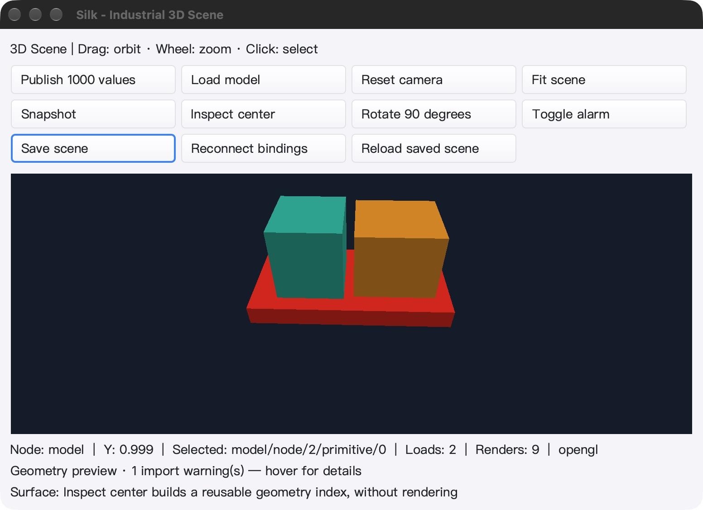

# GPU 驻留帧 SDK：实现与验收

这是 `da3a079` 之后的引擎增量，不是完整工业 IDE、Qt Creator 功能对等或整个设计器零读回的完成声明。

## 本轮实现

- `RenderGPU` 保留 GPU 颜色/ID 附件，不创建完整 CPU 图像、ID 或翻转缓冲；原 `Render` 继续提供兼容的 CPU `FrameView`。
- `GPUFrame` 是不暴露 GL 对象名称的借用令牌。变化绘制、尺寸改变、失败的目标修改和关闭会使旧令牌失效；缓存命中保留令牌。
- `PickGPU` 按需读取一个光栅 ID 像素（4 字节），不是用几何射线替代光栅可见性；`Readback` 显式读取完整附件并复用缓存。
- `BlitColor` 提供不透明颜色复制、物理像素坐标、显式裁剪与 nearest 缩放，恢复 read/draw framebuffer、源 read selector 和 scissor 状态。
- `Transfers` 区分颜色复制、颜色/ID 读取次数及字节数。它是 API 计数，不是驱动计时或整个应用的性能倍数。
- 所有驱动操作先检查 OS 线程和 context 归属；关闭竞争、外来/过期帧明确拒绝。兼容 `Render` 在驻留绘制和读回之间保持 OS 线程锁定。
- 生成绑定增加必需 `Scissor` 和可选 framebuffer blit：共 **59 项必需 + 3 项可选**入口。能力判断同时检查版本/扩展和入口；纯 Go 桩明确返回 `ErrUnavailable`。

代码与契约：`scene3d/glrender/resident.go`、`scene3d/glrender/resident_types.go`、`scene3d/glrender/blit.go`、`scene3d/glrender/renderer.go`、`scene3d/glrender/internal/gl21/`，以及 [后端说明](scene3d/glrender/README.md)。

## 完整回归

以下为每一轮的测试/子测试计数，不把 skip 或无测试文件的包计为通过。普通与 race 均使用 `-count=1`，未使用测试结果缓存。

| 平台 | 普通测试 | race 测试 | 有测试的包 / 无测试文件的包 |
|---|---:|---:|---:|
| macOS arm64 | 8,551 pass / 26 skip | 8,551 pass / 26 skip | 92 / 19 |
| Linux arm64 | 8,490 pass / 34 skip | 8,490 pass / 34 skip | 92 / 19 |
| Windows amd64 | 8,318 pass / 78 skip | 8,318 pass / 78 skip | 93 / 18 |

另通过：

- 三平台 `mod/map` race；三平台 `CGO_ENABLED=0` 场景 SDK；macOS `silk_pure_go` 的 paint/gui/ged/decl/scene3d 相关包。
- Windows/Linux amd64、arm64 场景 SDK 无 cgo 交叉编译；生成绑定复现与源码哈希一致性；SDK vet 和 GUI/IDE vet（保留项目既有 `-composites=false`）。
- macOS、Windows 的 5 项真实 gopls 集成断言，以及每平台 3 轮、每轮 3 项随包 gopls 集成断言。
- 表面放置回归 fuzz 60 秒，6,651,481 次执行，无失败。

典型复现命令：

```sh
go test -json -count=1 -timeout=30m -p 1 ./...
go test -json -race -count=1 -timeout=30m -p 1 ./...
(cd mod/map && go test -race -count=1 ./...)
CGO_ENABLED=0 go test -count=1 ./scene3d/...
SILK_TEST_SCENE_GPU=1 SILK_TEST_REQUIRE_INSTANCING=1 SILK_TEST_REQUIRE_BLIT=1 \
  SILK_TEST_NATIVE_BACKBUFFER=1 go test -race -count=1 -v \
  -run 'TestNative|TestScene|TestGLFWNativeBackbufferLifecycle' ./scene3d/glrender ./gui
```

最后一条需要支持所需能力的原生桌面/context；Linux 本轮通过 Xvfb/Mesa 运行，不能作为 Linux 硬件 GPU 验收。Windows 原生 GUI 检查由交互式计划任务在 Session 1 执行，不在 SSH Session 0 模拟点击。

## 驱动与真实 UI

- Apple M2 Max 与 Linux llvmpipe：驻留帧无完整 CPU 缓冲、4 字节拾取、裁剪/负偏移/缩放逐像素比对、GL 状态恢复、过期/错误 context/线程及并发关闭拒绝均通过。
- 原实例化 90 组、BVH 21 组 RGBA/ID 精确对照、两个 context 共 128 帧并发，以及普通控件树遮挡和生命周期回归通过。
- Windows：50 个独立原生测试进程、44 个不同用例通过，包含模态焦点、快捷键、IME、拖放、场景历史/持久化和 WGL 回退/清理。该机器报告 OpenGL 1.1，只验证 CPU 回退，**不计为 Windows 硬件 GPU 通过**。
- macOS、Windows 原生示例均实际完成：加载 glTF、发布 1,000 个点值、旋转/告警、保存→重载→重连绑定、拾取、拖拽视角、紧凑窗口和正常退出。独立 SDK 回读确认 8 节点、2 网格、3 绑定，创作根矩阵未烘焙动态点值；两平台的重复保存文件逐字节相同。
- 静置样本：macOS 约 10.03 秒消耗 0.14 秒进程 CPU，场景渲染计数 8→8；Windows 约 10.02 秒消耗 0.09375 秒进程 CPU，计数 9→9。这是单次示例进程样本，不是整个 IDE 或持续负载基准。
- macOS 正常 Cmd+Q 后确认 PID 消失，未取得 Launch Services 退出码；Windows 正常 Alt+F4 后确认退出码 0。

测试准备中的问题也保留了证据：首次临时 macOS 包没有内置资源，主线程阻塞于 Desktop 图标目录的 `os.Open`，通过采样/SIGQUIT 留下栈后停止该测试进程。给隔离 QA 包内置资源、模型和测试数据后，**同一二进制**完成上述 UI 流程；未修改系统隐私设置，首次启动不计为通过。Windows 首次定位与应用启动居中发生竞争，重新读取实际窗口位置并定位后才开始输入测试。




## 证据和剩余边界

完整日志、跳过项、脚本、进程身份、保存文件和最终门禁：`bin/qa-artifacts/resident-final-20261029/`。

```text
冻结输入：2566 个文件；测试前后逐文件校验
source.tar.gz SHA256:
6d36b7f4553ddad19d61500c97f959025e7f36708f8979066993f10173f5f8a3
Windows 最终证据归档 SHA256（208 个文件）:
22e0fd8ffc49f26923722f4df284ac7b4e53f53518e663ceb1e4817afff5b44e
两平台保存文件 SHA256:
de584f405fd7fba89fdc4f866b9ff16fa350f099d47ee2debc1cd39ff8f4024b
```

本报告及两张截图是测试后的非代码产物；不改动冻结输入中的代码、资源或构建配置。

**SceneView 仍使用兼容 readback 路径。** 有序 GPU 合成、所有权迁移、截图/导出、多视口与任意裁剪/混合算子的正确性仍需继续实现，不能改成覆盖菜单的悬空 overlay。单像素拾取仍同步，可能等待 GPU；本轮不宣称零延迟或完整应用提速。材质/纹理、MSAA、Windows 硬件 GPU、Linux 物理桌面和真实工业设备互通仍未完成，完整目标保持进行中。
