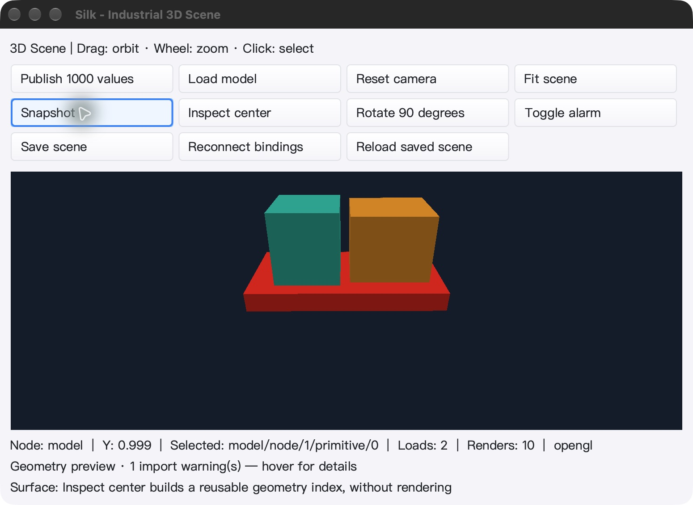

# SceneView 选择性读回与按需拾取验证 — 2026-10-29

本轮是工业 IDE / 3D 引擎的开发增量，不是整体目标完成或所有硬件性能认证。
所有下列终测已结束并通过；commit / push 在终测与源码一致性门禁之后执行。

## 更新

- SDK 新增 `Renderer.ReadColor(GPUFrame)` / `ColorFrame`：只捕获颜色，不分配/读取整张 CPU ID 图。
  同代颜色缓存可由完整 `Readback` 复用，完整捕获只补取缺少的 ID；保留旧 `Render` / `FrameView` API。
- `SceneView` 绘制使用 `RenderGPU + ReadColor`，`PickNode` 单独读取 4 字节 raster ID。
  场景变化后先拾取不下载颜色，下一次绘制补取颜色且不重复 GPU draw；HiDPI 坐标与缓存一致。
- macOS/Linux GLFW 和 Windows WGL 复用各自 context 绑定/恢复入口；错误线程在读取可变字段前拒绝，
  覆盖与 owner Close 并发的误用测试。auto 拾取失败释放 GPU 后回退 CPU，强制 opengl 保留失败诊断。
- `SceneView.GPUTransfers()` 与示例 `SCENE_STATE.gpu_transfers` 提供累计传输证据，不安装定时器。
- 仍经正常 Cairo 控件树绘制，未新增最终覆盖层或可见原生子窗口，因此没有绕过既有裁剪/菜单顺序。

无拾取操作的变化帧附件读回从 **8 降为 4 字节/像素**。这是 API 读回量，不等于 FPS 翻倍；
单像素拾取仍同步，颜色 readback、Cairo 合成和窗口纹理上传仍存在。

## 冻结源码与环境

- 基线：`e15a9abf6071072d91934fe8aeb9e9aa8761d8f1`；冻结 **2572** 个文件。
- 源码归档 SHA-256：`40ebf76dadf733dd1f42ff41ae377853f404251bcea29f4282e275445194ae13`。
- Windows 证据归档 SHA-256：`e1b5e83e1ed3d4c39cf4ec8cd94f0b15e00d2690a8a2970da00e38d3b022c4f2`。
- Go 1.26.10；macOS arm64、Linux arm64/Xvfb、Windows amd64。
- Windows 独立目录 `C:\silk_scene_selective_20261029`，UI/原生测试在交互 Session 1；全量测试在 SSH 会话。
- 详细日志、逐文件校验与最终机器可读判定：`bin/qa-artifacts/scene-selective-20261029/`，
  `final-validation.log` 的最终标记为 `FINAL_GATE_PASS`。

终测期间生产源码未变；本报告与两张非嵌入截图在终测后添加，并另存哈希。Git blob 与冻结源码
逐项比较；唯一允许的既有换行规范化为未编译的 `core/callback.go.txt`，还要求与基线 blob 完全相同。
不改动已有未跟踪的 review 文档、`gen_image/` 或 `silkide`。

## 全量与补充测试

普通与 race 均使用 `-count=1 -p 1 -timeout=30m ./...`，不是缓存结果。

| 平台 | 普通测试通过 / 跳过 | race 通过 / 跳过 | 有测试包 / 无测试包 |
| --- | --- | --- | --- |
| macOS | 8556 / 27 | 8556 / 27 | 92 / 19 |
| Linux | 8495 / 35 | 8495 / 35 | 92 / 19 |
| Windows | 8323 / 79 | 8323 / 79 | 93 / 18 |

跳过项明细保存在 `final-verdict.json`，不把跳过算作通过。补充门禁：

- 三平台 `mod/map` race；SDK CGO=0；macOS `silk_pure_go` 的 paint/gui/ged/decl/scene3d；
  Linux/Windows amd64/arm64 CGO=0 SDK 测试交叉编译；SDK vet 与 GUI/IDE vet（`-composites=false`）；生成绑定字节一致。
- macOS/Linux 实际 GL native race：选择性颜色逐像素/拾取一致、无 ID 分配、缓存升级、等面积不同形状 resize、
  错误/过期/跨 renderer/context/thread 令牌；沿用 90 例实例化、21 例 BVH、驻留帧 blit 和双 context 测试。
- GUI 原生探针检查颜色-only、单像素拾取、先拾取后绘制、分数/非对称 HiDPI、context 恢复、共享设备、
  同级覆盖、CPU/GPU 切换和关闭并发误用。标记：`GPU_COLOR_PASS`、`SCENE_SELECTIVE_PASS`。
- Windows **53 个独立进程 / 47 个不同原生测试**通过，包含菜单/模态焦点、IME、场景编辑、WGL 回退和新增选择性拾取测试。
- macOS/Windows 各 5 项真实 gopls 集成测试，另各 3 项随包 gopls 测试重复 3 轮通过。
- `FuzzSurfacePlacementFrames` 60 秒，6,858,138 次执行；无失败。

## 原生 UI 与持久化

两平台均完成：加载 assembly.gltf → 发布 1000 值 → 旋转 90° → 告警颜色 → 保存 → 重新加载 →
重连 3 条绑定 → 实际点击拾取 → 空闲采样 → 原生拖动旋转 → 再保存 → 缩小窗口 → 正常退出。
独立 SDK 重新读取保存文件、Build、渲染及扫描拾取像素，验证 8 节点 / 2 网格 / 3 绑定；
创作根变换保持 Identity，未把实时点位烘焙进文档。跨平台两次保存字节完全一致：
`de584f405fd7fba89fdc4f866b9ff16fa350f099d47ee2debc1cd39ff8f4024b`。

- macOS：Apple M2 Max / OpenGL 2.1 Metal；前 8 次场景绘制 ID 传输为 0，实际点击一次后仅 4 字节；
  后续拖动与 resize 不再增加 ID 传输。最终颜色捕获 10 次、ID 读取 1 次。
  空闲 14.612 秒，进程 CPU 0.180 秒，render 与传输计数不变。
  使用 race 构建及含 Resources/icon 的隔离 QA bundle；Cmd+Q 后进程退出，未采集 LaunchServices 退出码。
- Windows：CPU 回退；空闲 10.024 秒，进程 CPU 0.015625 秒，场景 render 计数保持 9。
  普通示例构建正常 Alt+F4，进程句柄验证退出码 0；原生测试二进制为 race 构建。
  初次 QA 定位与程序居中存在时序，确认窗口最终位置并重新定位到原点、检查新截图后才执行按钮测试。

单次空闲采样不是吞吐基准。Windows 当前驱动仅 OpenGL 1.1，验证了真实 CPU 回退与诊断，
**没有验证 Windows 硬件 GPU 性能**；Linux 是 llvmpipe 软件 GL，不是物理 GPU/桌面验收。

### macOS 实际窗口

### Windows 实际窗口

## 继续开发边界

有序 GPU 直接合成、完整材质/纹理/PBR、大场景硬件性能和真实工业 I/O 仍待完成。
不能把场景无条件加入最终 GL overlay；必须继续保证菜单、弹层、同级控件、复杂裁剪和导出顺序。
