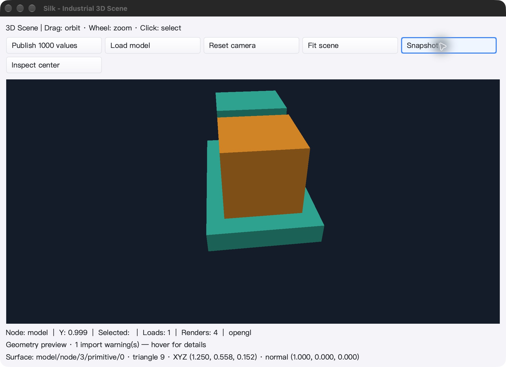
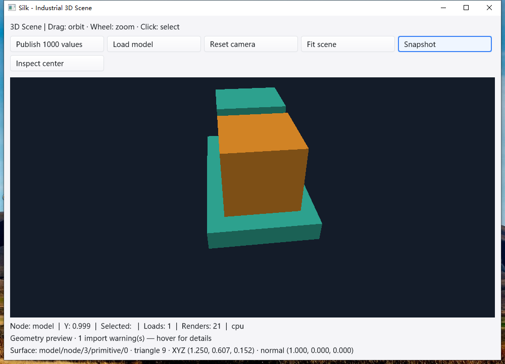

# 几何表面查询 SDK 与原生控件验收

基线 `17893a11ac14e830cc566d090b421ad3429cfc4b`。本增量最终机器门禁 **PASS**：冻结源码的三平台普通/race 全量、原生专项、真实 UI、语言服务及提交前一致性检查全部通过。

## 交付范围

- `scene3d.RayIndex`：不可变的三角/实例双层 BVH，Mesh 共享、快照 refit、缓存淘汰、显式内存预算和取消；并发查询不依赖帧缓冲或 GL context。
- `RayHit`：稳定节点/原始三角索引、世界距离、世界/局部坐标、法线、重心坐标与正反面；距离限制、排除单节点、可选背面剔除。
- `SceneView.SurfaceAt`：使用后台准备的索引，在 UI 线程按逻辑坐标和当前相机裁剪查询；拒绝不同快照，包括同 revision 的不同场景。不替换 `PickNode`，不渲染、不 GPU 读回、不改变选中节点。
- `examples/scene3d` 增加 Inspect center：显式后台准备、取消、重复点击保护、状态与结构化 `SURFACE_QUERY` 输出；按钮随宽度换行、底部三行分开布局。状态是上次显式采样，不自动跟随刷新。
- 不包含设备表面吸附、持久化附着/测量、多选、材质/纹理、SAH/LOD 或 GPU 直接合成。整体工业 IDE 目标仍未完成。

## 数值与资源回归

- 新增对照实现采用独立 Moller–Trumbore，不复用生产三角谓词或 BVH；随机反射/剪切/层级变换、refit 后再次对照。
- 极端坐标回归先证实并修复两个问题：统一缩放尺度吞掉极小投影轴；`origin + direction*t` 在远射线下抵消表面位置。现在分轴二进制缩放并从局部重心坐标重建世界表面点。
- 包含共享边/顶点、平行/共面、奇异变换、1e±300 尺度、巨大有限边、无效参数、取消中断、失败不发布、10,000 实例与 131,072 三角访问上界、零分配和并发快照。
- 默认/硬上限 64 MiB 是保留索引估算，不是源 Mesh/临时质心区/所有历史索引/RSS 总量。普通浮点几何，不宣称任意精度或像素/MSAA 完全一致。

## 完整矩阵

主模块均使用冻结源码、`-count=1 -timeout=30m -p 1`，分别执行普通及 `-race` 全量；`mod/map` 独立 race。
统计包括子测试，跳过项不计入通过数。

| 平台 | 普通通过 / 跳过 | race 通过 / 跳过 | 有测试 / 无测试包 |
| --- | ---: | ---: | ---: |
| macOS arm64 | 8,537 / 25 | 8,537 / 25 | 92 / 19 |
| Linux Xvfb / Mesa | 8,476 / 33 | 8,476 / 33 | 92 / 19 |
| Windows 10 amd64 | 8,304 / 77 | 8,304 / 77 | 93 / 18 |

其他门禁：SDK 完整 race；13 个新增顶层测试各 20 轮 race（文档 Example 按 Go 规则只执行一次）；独立对照与极值缩放 fuzz 各 60 秒，分别 1,931,414 / 3,869,276 次；投影 fuzz 60 秒 3,027,273 次。

macOS/Linux 原生 GL 明确启用 GPU/实例化/backbuffer 环境，90 个精确 RGBA/pick 实例化案例、21 个 BVH 案例及 context 生命周期通过；不以环境默认跳过代替专项。

CGO_ENABLED=0、silk_pure_go、SDK vet、GUI/IDE vet（-composites=false）和实际构建均通过；额外 Windows arm64、Linux amd64/386、macOS amd64 仅为纯 Go SDK 测试二进制交叉编译，不代表这些架构运行通过。

macOS/Windows 各自真实 gopls 5 项及打包工具补全/格式化/重命名/导航 3 轮 × 3 项全部通过。Windows 原生 race 专项覆盖 39 个不同案例、45 个独立进程（3 个焦点敏感案例各 3 轮），均在已验证的前台父窗口启动，记录 PID + 启动时间身份，全部 exit=0，无跳过或 DATA RACE。

M2 Max 静稳微基准：131,072 三角网格的一条固定射线约 **2.399–2.406 µs/op、0 B/op、0 allocs/op**；独立线性对照约 **1.550–1.569 ms/op**。只比较这个查询夹具，不是建树时间、复杂场景吞吐、渲染提速或整应用 FPS。

Windows Xeon E5-2686 v4 测试机的同一查询夹具约 **13.453–16.013 µs/op、0 B/op、0 allocs/op**；线性对照约 **9.417–9.738 ms/op**。三轮在全量/原生/UI 进程退出后执行，同样不是整应用性能指标。

## 真实桌面闭环

### macOS

CUA 点击实际示例：重复查询 → 发布 1,000 个点位样本 → 重新查询 → 拖动相机 → 加载 glTF → 查询 → 缩小窗口 → 查询 → Cmd+Q。

- 六次查询均在 UI 线程交付且各自 `renders_before == renders_after`；重复命中完全相同。
- 点位更新后复用两个 Mesh BVH、refit 实例树；相机拖动改变表面点；glTF 替换后使用新的 24 三角几何。
- 缩小窗口后按钮重新排列，无相互覆盖；中心命中保持完全相同，长状态文本由 tooltip 提供全文。
- 10.008 秒空闲采样消耗约 0.03 CPU 秒，渲染次数保持 4；只是单次样本，不是持续性能保证。
- 本机实际 OpenGL：Apple M2 Max。查询本身仍为 CPU 几何算法，不把该数据当 GPU ray tracing。
- Cmd+Q 后 PID 37911 消失；LaunchServices 不提供退出码，因此不声称 macOS exit=0。
- UI 二进制和冻结源码完整构建的示例 SHA-256 相同；输入夹具字节不变。

### Windows

通过 win10testcomputer skill 在交互式 Session 1 驱动实际示例，非 SSH Session 0 合成 UI：

- 六次查询涵盖相同闭环，验证线程、网格复用、旧场景替换、相机变化、resize 后中心点完全一致以及无额外渲染。
- 约 10.036 秒空闲消耗 0.03125 CPU 秒，渲染次数保持 21、窗口持续响应；相机拖动的中间帧计入渲染次数。
- 正常 Alt+F4，已打开的进程句柄取得退出码 **0**，PID 10608。
- 实际视口为 CPU fallback，不代表 Windows 硬件 GPU；Linux 是 Xvfb/Mesa，不代表物理桌面。

## 测试过程中的问题与边界

- 首次 Linux/Windows 调度早于冻结脚本完成，未找到 runner，未执行测试；保留调度失败日志。其后数值复查发现远射线坐标抵消，旧候选整体标为 SUPERSEDED，停止旧进程并以修正后源码完整重跑；不把旧候选通过用于最终结论。
- macOS 第一次从 Desktop 测试目录启动，进程在 Go main 前的 libc getcwd/open 阻塞，CUA 查询超时。未修改隐私权限；把**相同二进制**和明确选定的工程夹具复制到独立临时目录后完成原生验证。该路径不证明原始 Desktop 启动限制已解决。
- Windows 第一版验收脚本在 PowerShell 5.1 将单个查询结果解包成 PSCustomObject，`.Count` 为 null，误报 QUERY_CONTRACT_FAILED；原查询的节点、UI 线程、错误与渲染断言均正确。保留原记录，显式数组捕获修正脚本，不改产品、不放宽断言；正常关闭后从干净进程完整重跑。
- 原生专项观察脚本等待完整矩阵超过 60 分钟而超时；此时普通/race/map/build 均已 exit=0，完整 runner 继续执行语言服务检查，未重启测试。保留观察失败日志，仅将观察期限延长为 120 分钟，待 runner 成功后再执行原生专项。
- 示例状态栏为显式采样结果，不会随相机/点位自动刷新；没有增加空闲轮询。没有现场工业点位、驱动或真实硬件互通验收。

## 源码与证据

最终冻结 2,551 文件，归档 SHA-256：

`ae8f9c883e32468d87c0d7619ccbd4163838fc48dab0bfa9c8b5a88975b5c247`

`bin/qa-artifacts/surface-verified-20261029/` 保存完整逐包日志、条件跳过、前后源码校验、真实 UI 的 JSON/截图、测试二进制哈希、原生进程身份/退出记录和最终机器判定。
原始极值失败用例在 `bin/qa-artifacts/raycast-20261029/`；被替代候选在 `bin/qa-artifacts/surface-final-20261029/`。不提交这些大型运行产物。

最终 Windows 证据包 SHA-256：`6dd3ab5c3826a87ec76f85ccd5095bce7729cd81f08d03210c80ccfc8306448e`。机器核验脚本输出 `FINAL_GATE_PASS`；所有待提交源码与 2,551 文件冻结清单一致。最终报告及两张界面截图在测试结束后汇总，不改变被测实现。
