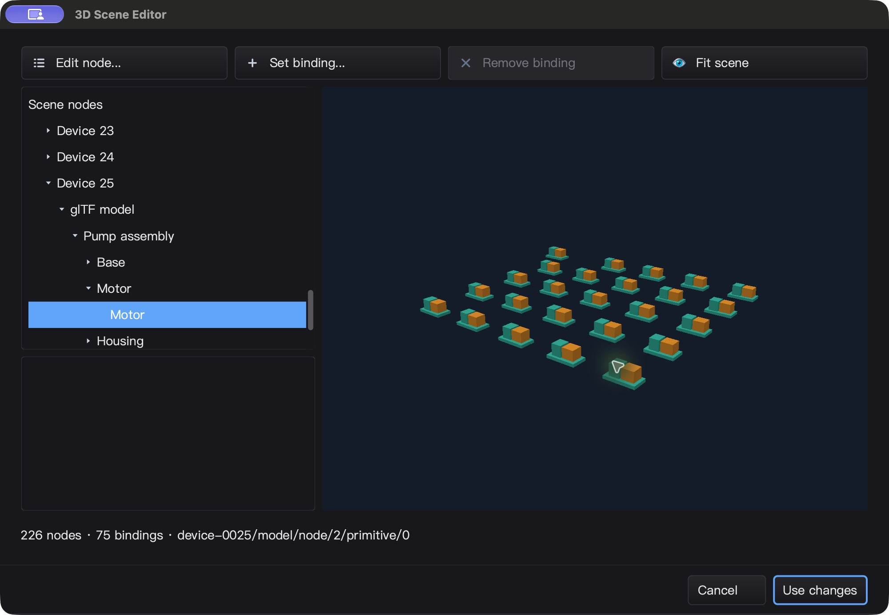
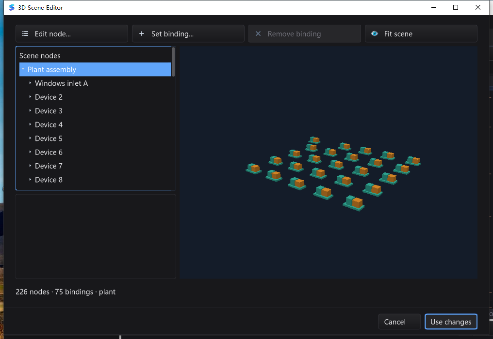

# 设备模板 / 批量产线组装 QA — 2026-10-28

> 阶段记录：以下保留本候选的实现、失败和测试边界；文中的待验收/未提交状态描述的是当时的候选。
> 最终整合版本使用独立的 2500 文件冻结清单重新验证，当前提交门禁与平台结果见
> [最终验收矩阵](SCENE_RELEASE_QA_20261028.md)。旧候选结果不替代最终版测试。

基线 `493136e`。本轮保持工业组态、代码开发、高性能 3D 与跨平台控件的完整目标；
以下是设备组装这一阶段的证据，**不是整个 3D 引擎或 Qt Creator 对等能力的完成声明**。

## 新增能力

- `scene3d.NewTemplate` 编译创作文档，验证/复制几何一次；模板不可变，可用于多个独立所有者
  的目标场景。放置共享 Mesh，但不共享节点位置、颜色、可见性或绑定目标。
- `Instantiate` / `InstantiateBatch`：无网格设备根节点、保留内部层级与绘制顺序、稳定 ID
  映射、独立点位前缀和显式 TagMap；没有隐式订阅、设备连接或点位创建。
- 批次只复制一次目标节点元数据。验证成功后仅增加一次 revision；取消、ID 冲突、非法
  映射、数值/布尔混用、世界矩阵溢出、节点/三角形/文本预算失败均保持旧场景及缓存不变。
- `examples/scene3dplant` 从 OBJ/glTF/GLB/`.silkscene` 生成可在现有 IDE 中打开的产线文档。
  实际运行并回读：25 台设备为 226 节点 / 75 绑定；1000 台为 9001 节点 / 3000 绑定，
  两者都只有 **2 个唯一序列化网格**。每个可见实例仍计入快照预算。

## 原生操作发现并修复的相机跳变

25 台设备的原生 macOS 编辑链发现：修改设备名称/位置后，整条产线偏移，部分设备离开
视口。`UpdateNode` 重建场景时调用公共 `SceneView.SetScene`，该接口为新模型重置了
`target`，却保留旧相机距离。问题不是模板变换或节点互相串改。

先补回归测试，修复前实际失败：`editing a node changed the observation camera
{20 0 30} {0 0 0}`。修复限定在结构化编辑器：替换已验证编辑结果时保留观察中心；旋转、
俯仰、距离和显式 FitScene 契约不变。`SetScene` 的新模型语义没有被全局修改。

- V1 候选与其正在运行的测试明确退役，失败截图/日志单独保留，不算最终通过。
- 修复后相同回归及 GUI race 用例通过。
- V2 原生 IDE 从干净产线重新开始：只改第一台设备名称为 `Inlet pump A`；对视口区域
  `(730, 200)-(1940, 1140)` 的 **1,137,400 个像素**逐个比较，重命名前后完全相同。
- 再把第一台设备局部 X 改为 -4：只移动该设备，整个场景视角不再跳动；子模态自动返回。
- 拾取第 25 台绿色 Motor 后，节点树展开对应祖先，稳定 ID 为
  `device-0025/model/node/2/primitive/0`。
- Use changes + 保存后读回：只有 `device-0001` 的 name / transform 变化，其余节点、
  两份几何、75 条绑定与警告完全不变。一次 Undo + 保存精确恢复原始字节；Redo + 保存
  精确恢复修改版；命令面板重新打开后取消不改变文件，正常退出 0。

V2 macOS IDE 二进制 SHA-256：
`0db24313e73b695866f9e853202c6b7dc0e65f99051771406fe5dd5d59d91da8`。
原文件 SHA-256：`6c0065dae6e1d54b1ec318353f52048d7f47446f35dd69e3a3e56639bb121460`。
修改版 SHA-256：`9b3664df1bdbb69b6cb663d18fd8f0ff0a4c161efec1cffa2d06f5fa4ed18a51`。

### Windows 10 真实桌面复验

最终候选 IDE 在 Session 1 中运行，使用真实菜单/命令面板、原生子窗口和键鼠输入；每步
检查窗口所属 PID、前台标题及遮挡，不以 SSH Session 0 的模拟输入作为 UI 证据。

- 同一 25 设备文件打开后为 226 节点 / 75 绑定。第一台重命名为 `Windows inlet A`，
  Apply 自动回到父模态；视口 `(375, 100)-(980, 570)` 的 **284,350 个像素**完全相同。
- 再将该设备 X 改为 -4，提交并保存；完整文件比对只有 `device-0001` 发生变化，
  其余节点、2 个网格、绑定与警告不变。一次 Undo / Redo 各自精确恢复原始/修改版字节。
- 命令面板重新打开后可见保存的名称，取消不改文件；Alt+F4 正常退出码 0，stderr 为空。
- 额外一次静止采样：10,007 ms 墙钟内累计 62.5 ms 进程 CPU（约 0.62% 单核等效）；
  只说明这个固定场景的空闲样本，不是普遍性能、交互 FPS 或硬件 GPU 验收。

Windows IDE SHA-256：
`4abd9edfdf4c2f599b2724e5407b1280e1a31e5f7d11c6d6cdb5f1a4835531e1`。
Windows 修改版 SHA-256：
`e92f647bfe8c0d9ee355c81afc18ca04cf2a3b4676125bab84ea3fa56a97f4ff`。

另外从同一冻结源码构建原生 GUI race 二进制，在 Session 1 补跑输入法、快捷键、
模态/嵌套窗口前台归还、初始化失败及 WGL 显式回退，并包含本轮模板绑定与相机回归。
17 个顶层用例、23 次独立进程运行（3 个前台/嵌套用例各重复 3 次），**33 条 pass，
0 skip / 0 fail**；逐个读取真实退出码。沿用已验证的前台启动器与每用例独立 UI 线程
前置条件，不冒称修复了单进程跨多个原生 UI 线程批跑的激活限制。
race 二进制 SHA-256：
`a20319f252c9277ef17e0672386df1e428514f28455f1b970051ee8b0a00f89b`。

原生截图（未重绘/修饰）：

## 自动测试与性能证据

新增覆盖：模板/文档/实例的所有权隔离，24 个 goroutine 使用独立目标的 race 检查；
批次前/中/提交前取消，后半批次碰撞、层级父节点、同类型 fanout、混合类型别名、快照
三角形预算和聚合文本预算；模型加载 → 实例化 → 点位更新 → 创作基线导出 → 重载 →
再次应用 → 像素与拾取完全一致。GUI 测试还检查 1000 次更新共用一条 UI 投递、不同设备
状态隔离、隐藏后不可拾取、静态帧复用、关闭后排队更新不穿透生命周期。

- SDK 与新示例 race：通过。
- 新 GUI / 文档编辑 / 相机回归 race：通过。
- `CGO_ENABLED=0 go test -count=1 ./scene3d/... ./examples/scene3dplant`：通过；两个 GPU
  子包显示无测试，不把 stub 当 GPU 验收。
- `go vet ./scene3d/... ./examples/scene3dplant` 与 GUI `go vet -composites=false`：通过。
  未宣称全仓库默认 vet 清零，既有告警见上一轮报告。
- 模板放置 fuzz：45 秒预算，2,719,797 次执行，PASS；包括原子失败及成功结果能被正式
  `NewBindingSet` / Snapshot 接受的性质检查。
- macOS 普通与 race 全量：各 8,279 个测试/子测试通过，22 个跳过；Linux 普通与 race
  全量：各 8,217 个通过，31 个跳过。每次均为 92 个包通过、19 个包无测试，无失败。
  Windows 普通全量为 8,056 个通过、74 个跳过（93 个包通过、18 个无测试）；Windows
  race 最后观察仍在运行，随后 SSH 收集连接异常，**尚未取得最终退出码，不算通过**。
- macOS / Linux 额外原生场景、backbuffer、GL 上下文/生命周期 race，以及独立
  `mod/map` 模块 race：通过。macOS 另跑 `silk_pure_go` 控件/设计器与 CGO=0 场景测试通过。
- 默认全量环境未把工具目录加入 PATH，5 个真实 gopls 用例跳过；随后显式使用仓库已有
  `bin/tools/gopls` v0.24.0（SHA-256
  `e4a710f35c02b5a80af11d0eed08bd8d01204d776b1e5a354768eb37abd3a072`）补跑 macOS race：
  未保存 Unicode 补全/格式化、重命名、导航和初始化 **5 个通过、0 跳过**。
- 另按正式 `test-bundled-gopls.sh` 在独立 staging 中验证完整工具包，再通过邻近工具解析器
  （禁止 PATH/显式 override 回退）补跑 3 个真实 LSP 用例，全部通过。初次 staging 漏复制
  licenses，被校验器正确拒绝；原始工具包许可证齐全，补齐复制后重跑，未改校验器。
- macOS 原生光标、纹理完整/局部上传、弹层 alpha 额外 race 用例 3 个通过；打包脚本与
  release-version 规则测试通过（模拟文件系统/版本 fixture，不代表发布了新制品）。
- Windows 与 macOS 原生 25 设备编辑链：通过，证据如上。

Apple M2 Max / Go 1.26.10，同一个 4 节点 / 3 绑定测试模板，1000 设备批次：

| 实现 | 耗时（3 次基准） | 分配量 | 分配次数 |
| --- | --- | --- | --- |
| 本轮首版，为验证临时编译整套 BindingSet | 4.411–4.440 ms/op | 9,168,259–9,168,274 B/op | 39,191 |
| 复用已验证模板，仅验证变化的点位名称/类型/预算 | 2.283–2.331 ms/op | 3,582,762–3,582,777 B/op | 24,048 |

这是**本轮内部实现对比、场景组装阶段**的基准，不是相对上一发布版本的整体提速，也不是
GPU 硬件实例化、渲染 FPS、输入延迟或大场景交互性能保证。几何不复制由指针同一性、
跨场景/文档隔离与序列化去重检查共同验证，而不是从时间数字推断。

## 测试源码与环境边界

- V2 冻结 2476 个源码/资源文件，三平台使用同一 SHA-256 manifest。V2 只比 V1 改变相机
  修复和其回归测试文件；模板源代码、fuzz/性能测试对应的 SDK 代码没有变化。
- macOS 首次以位于主仓库忽略目录内的无 `.git` archive 测试时，Git guard 发现祖先仓库却
  列出零个文件，`TestNoDirectUndoStackPushOutsideTheDoor` 因非真空验收断言而失败。
  未放宽测试、未跳过断言；改用真实独立 QA worktree，登记全部新增 Go 源码，再次逐文件
  核对相同的 2476 个哈希后重跑。该环境失败与已退役运行均保留，不算最终通过。
- Linux 使用 Xvfb/Mesa 软件 GL，不是物理桌面或硬件 GPU；Windows 测试机 GPU 能力限制
  仍在，不能用 CPU fallback 冒充 Windows 硬件 GPU 验收。
- QA IDE 未打包 gopls；JSON/3D 原生编辑链不是 LSP UI 验收。上述真实 gopls 补测是自动化
  服务集成测试，不代表 Windows/Linux 工具打包、原生补全弹窗或完整调试器验收。
- 设备库拖入、交互式节点复制/删除、gizmo、材质/纹理、硬件实例化、GPU 直接合成、
  BVH/LOD 和真实大场景性能仍待继续开发与验证。现有模板不是这些能力的替代品。
- 本地证据：`bin/qa-artifacts/scene-template-20261028/`；源文档、修改版、截图、
  断言 JSON、冻结 manifest、各平台原始日志分别保存，临时二进制不提交。
