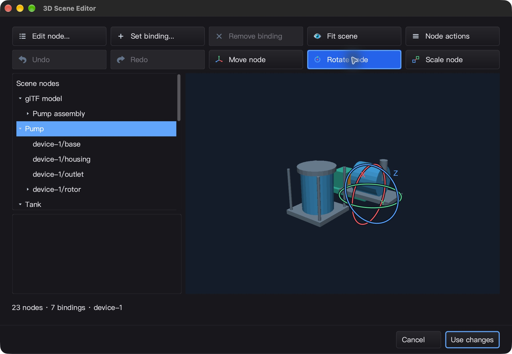
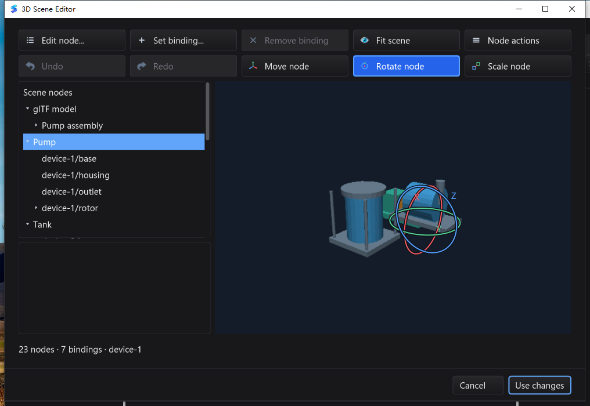
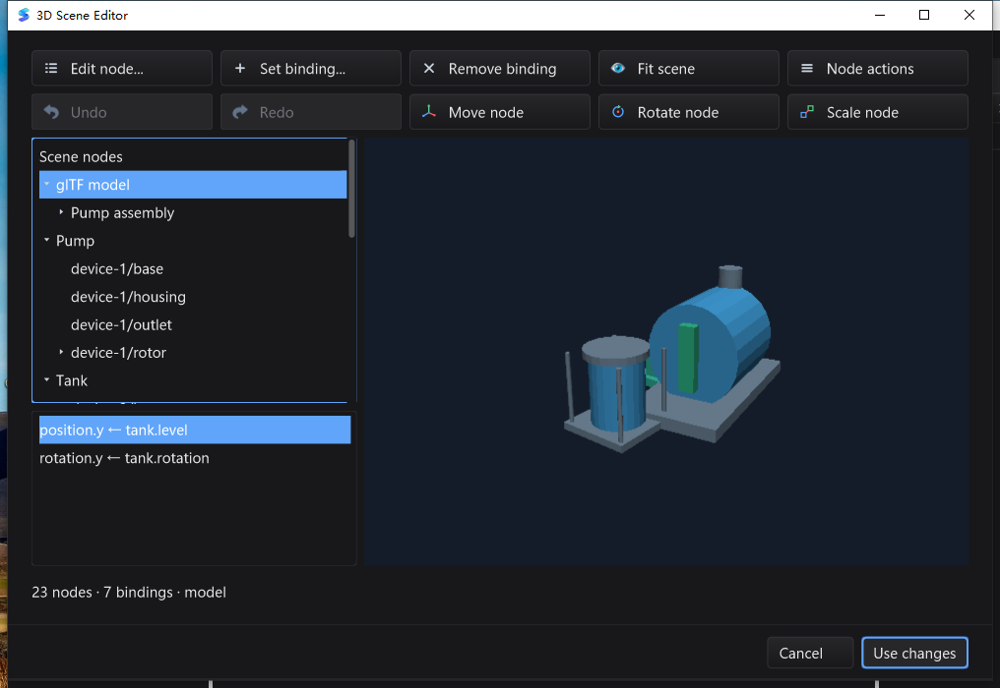

# 世界轴旋转与缩放验收

基线 `5f1dd58d9bec11e0b9ed50cb3dba4c89258101e0`。修正分配计量测试后的三平台完整复跑、真实 UI 和最终一致性门禁均为 **PASS**。

## 实现范围

- SDK：`RotationAxis`、`RotationDrag` 多圈求解、`TransformEdit` 单步事务；保留父级反射、非均匀缩放、剪切与节点原点。不做有损 Euler/TRS 分解。
- 编辑器：Move / Rotate / Scale 互斥按钮，XYZ 旋转环、轴向/中心等比缩放、Shift 吸附与插件配置 API。
- 生命周期：Escape、失焦、捕获丢失、尺寸/相机变化、隐藏、禁用、工具切换、无效输入与过期修订取消预览；一次拖动仅产生一个历史项。
- 绘制：旋转环投影缓存、工具切换不重建几何缓存、HiDPI 裁剪；图标沿用矢量系统。不添加空闲帧定时器或浮动原生子窗口。

## 完整测试矩阵

所有主模块全量命令均带 `-count=1 -timeout=30m -p 1`，普通与 `-race` 分别运行；使用冻结的干净源码，避免历史构建目录污染 `./...`。
统计包括子测试事件，条件跳过与无测试包单独列出。

```sh
go test -json -count=1 -timeout=30m -p 1 ./...
go test -json -race -count=1 -timeout=30m -p 1 ./...
(cd mod/map && go test -race -count=1 ./...)
```

原生 GL 专项显式启用 `SILK_TEST_SCENE_GPU=1`、`SILK_TEST_REQUIRE_INSTANCING=1`、
`SILK_TEST_NATIVE_BACKBUFFER=1`；Windows 模态/IME/WGL 专项通过交互式计划任务运行，
不能以默认跳过这些环境用例的全量结果代替。

| 平台 | 普通测试通过 / 跳过 | race 通过 / 跳过 | 有测试 / 无测试包 |
| --- | ---: | ---: | ---: |
| macOS | 8,502 / 25 | 8,502 / 25 | 92 / 19 |
| Linux Xvfb / Mesa | 8,441 / 33 | 8,441 / 33 | 92 / 19 |
| Windows 10 真机 | 8,269 / 77 | 8,269 / 77 | 93 / 18 |

其他已通过项目：

- `mod/map` 独立模块 race（macOS / Linux / Windows）。
- macOS / Linux 原生 GL、实例化、BVH、backbuffer 生命周期专项；GPU 实例化 90 个精确 RGBA/pick 案例、BVH 21 个案例。
- SDK 完整 race；新核心事务/GUI 交互 race 连续 20 轮。
- 旋转轴/角度解绕 fuzz 60 秒，7,089,735 次执行；投影回环 fuzz 60 秒，4,742,160 次执行。
- macOS `CGO_ENABLED=0`、`silk_pure_go`、SDK vet、GUI/IDE vet（`-composites=false`）及 IDE 构建。
- macOS、Windows 各 5 项真实 gopls 集成测试；两平台各自打包 gopls 的补全、格式化、重命名与导航集成测试 3 轮 × 3 项。
- Windows 真机 `CGO_ENABLED=0` SDK 回归、IDE 构建、打包工具及许可证校验；36 个 GUI / 原生用例在 42 个独立 race 进程中执行，包含焦点敏感用例各 3 轮。所有相关进程退出码为 0，无 race 报告。

M2 Max 微基准：10,000 节点 session 上单次 `TransformEdit.Transform` 约 **136.9 ns/op、0 B/op、0 allocs/op**。仅指预览矩阵运算，不包含完整渲染、场景提交或实际 UI 帧率。

## 回归中修正的测试问题

首轮 Windows 普通全量通过，但完整 race 中 `TestEditorReadOnlyQueriesAllocateNothingOnLargeSelection`
测到每轮 2 次分配。该断言使用 `runtime.MemStats` 的进程级计数；独立运行当前候选与上一发布版本
`5f1dd58` 的测试二进制各 50 次均为零。未具体定位是哪一个其他后台 worker 贡献了分配，
因此不把这次测量误称为已修复的编辑器运行时分配缺陷。

- 沿用仓库 UTF-16 分配测试的隔离方式：启动同一测试二进制的独立子进程，保留 race、30 秒超时与严格零分配断言；父进程验证子测试确实执行并通过。
- 未放宽阈值、跳过测试或以重试取最小值。Windows 隔离版连续 20 轮 race 已通过。
- 负向控制通过仅作用于验证构建的 Go overlay 注入每轮一次分配，确认子进程和父测试都会失败；产品源码没有该注入。
- 原始失败矩阵、修正前 50 轮诊断与首轮全部证据保留于 `bin/qa-artifacts/transform-final-20261029/`。修正后重新冻结并完整复跑三平台，不用单项重跑替代全量。

## 真实桌面闭环

### macOS

CUA 在实际原生 IDE 中打开唯一夹具 `transform-target.silkscene`，选择 Pump，拖动 Y 旋转环与中心等比缩放手柄，然后执行两次场景 Undo/Redo、Use changes、Save：

- 只修改 `device-1` 的 transform，原点、23 节点、6 个网格、7 个绑定保持不变；等比缩放约 1.617482 倍。
- 两次 Redo 后模型视口与提交前像素一致；两次 Undo 恢复不同的原始形态。
- 宿主 Undo/Save 与原始文件字节完全一致，Redo/Save 与保存文件字节完全一致；重开可见变换，取消不改文件。
- 正常 Cmd+Q 后 PID 62233 消失。LaunchServices 未提供退出码，不声称 exit=0。
- 原生测试构建与冻结候选的 883 个生产 Go 文件哈希一致。



### Windows

通过 `win10testcomputer` 在交互式 Session 1 驱动实际 IDE，不把 SSH Session 0 的合成事件当作桌面操作：

- 打开同一干净夹具，拖动 Y 旋转环与中心等比缩放，分别记录每一步 Undo/Redo 截图。
- Save 回读确认只修改 `device-1`，原点不动，23 节点、6 网格、7 绑定保持不变；矩阵列长度相等且存在非零 Y 旋转。
- 宿主 Undo/Save、Redo/Save 均字节精确，重开显示保存结果，取消不改文件。
- PID 10492 正常 Alt+F4，取得进程句柄并验证退出码 **0**。
- 每一步 Undo/Redo 的模型视口像素精确匹配，旋转与缩放各自确实改变了模型；矩阵复核为等比缩放约 1.786951 倍。
- 单次空闲采样约 10.49 秒消耗 0.078125 CPU 秒且始终响应；这是一次现场样本，不是持续帧率或吞吐基准。
- 42 个独立原生 race 进程全部通过；2,541 个文件前后哈希一致，实际 UI 使用的 IDE 与最终构建二进制 SHA-256 相同：`45b9b3f6ce42dcf6c72ea27c37760486b8954b30ca7a8fcad31415a748751674`。
- 原生进程身份使用 PID + 创建时刻；首次验收器把 Windows 合法复用 PID 当成重复启动，42 次测试本身均通过。保留首轮证据，补充创建时刻后以全新数据目录重跑 42 次并通过，不降低测试断言。




## 证据与边界

冻结候选共 **2,541 文件**，归档 SHA-256：

`4a11063d13a8682d259cf2001568faaca2cbcfcb4b3e0e5eab1415c6b710fd96`

- 最终测试目录：`bin/qa-artifacts/transform-verified-20261029/`。最终冻结只比首轮改变 `gui/codeeditor_readonly_test.go`；生产 Go 源码不变，实际桌面证据通过源码哈希与最终 IDE 二进制一致性复核关联。
- 最终机器可读结论：`final-verdict.json`；逐包日志、条件跳过清单、原生进程创建/退出记录、UI 像素与文件回读均存于最终测试目录。
- 初始 SDK/race/fuzz 与原生 macOS 记录：`bin/qa-artifacts/transform-20261029/`。
- 首次 macOS 文件对话框自动化过早发送路径，误开上一轮私有 QA 夹具；已通过宿主 Undo/Save 字节精确恢复，并以唯一文件名核实路径重跑。Windows 自动化的过早启动及本地化文件对话框标题假设也已保留失败记录并纠正；不是产品保存失败。禁止用 Save toast 代替目标文件回读。
- Windows 本轮实际视口使用 CPU fallback，不代表硬件 GPU 通过；Linux 为 Xvfb/Mesa，不代表物理桌面验收。无真实工业点位/驱动接入。
- 当前为单选、世界轴、节点自身原点；多选、局部轴、任意支点、材质/纹理等不在本增量范围，整体工业 IDE 目标仍未完成。
