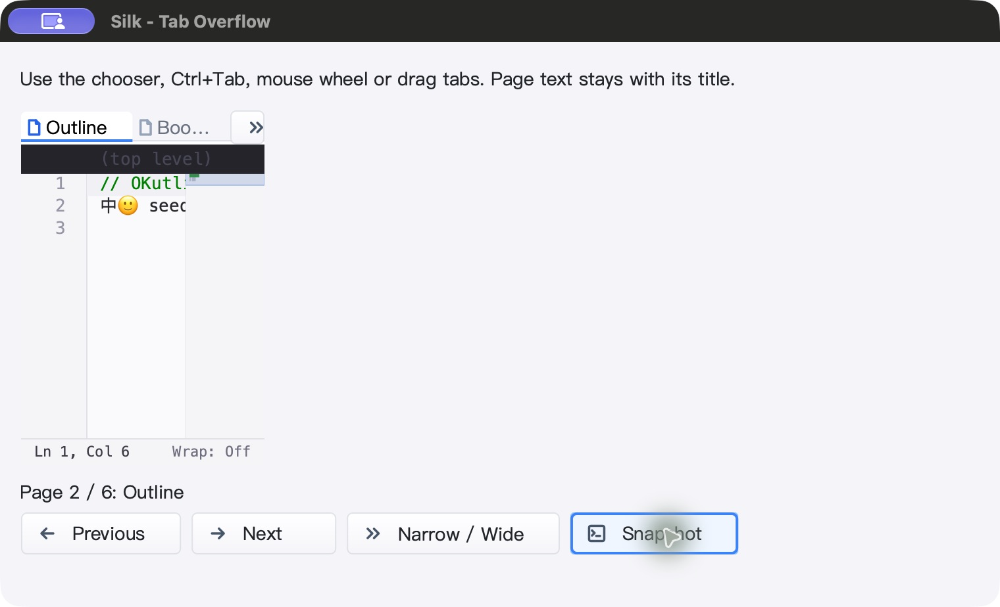
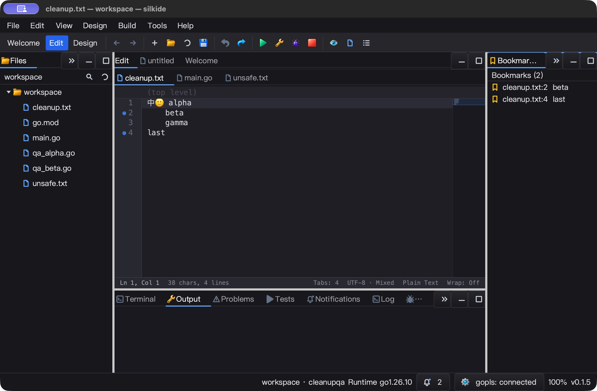
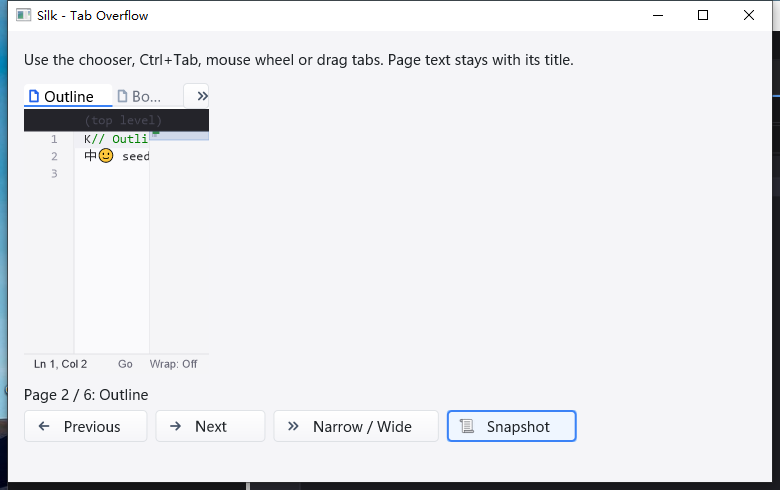
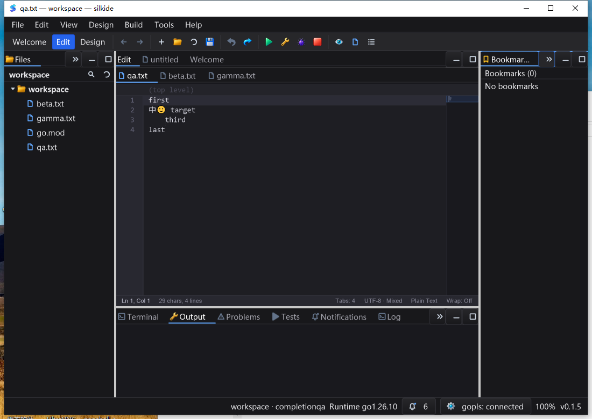

# 页签几何与原生输入 QA — 2026-10-25

## 修复与复现

上一轮窄停靠区仍显示前一标题的尾巴。本轮先加入三个失败回归，再统一可见区：

- 左端对齐实际页签边界；右端按剩余宽度省略标题，而不是直接裁掉字符。
- 太小的末端余量留空；图标和关闭按钮必须完整容纳，绘制与热区一致。
- 点击、关闭、拖拽插入点使用相同的 `paintWidth` 与可见索引区间。
- `TabWidget` 子标签栏高度不得大于 owner；旧实现 0×0 owner 仍留下 0×26 子控件，
  单独失败回归后修复。覆盖零尺寸、分数宽度、Unicode、选中恢复、空白热区和拖放。
- 增加独立 SDK 示例 `examples/tab-overflow`，原 `examples/tab-navigation` 未修改。
  新示例包含溢出选择器、切页、宽窄模式、拖拽、关闭、编辑和 JSON 快照。
  首次实机发现错误图标名返回红叉占位而非 nil，修正资源名并增强占位图标断言。

实机又发现两项被合成键盘／鼠标单测遗漏的 macOS 问题：

1. **Control-Tab 被 Cocoa 截获。** 同一按键已经到达 Cocoa local monitor
   （keyCode 48，Control/Control+Shift），却没有到 GLFW onKey；普通 Tab 和
   Control-PageDown 正常。修复用窗口生命周期绑定的局部 monitor，只将该 chord
   交给原内容视图的 keyDown/keyUp，并消费原事件以免重复。仍由既有路由执行导航。
   输入法、Command/Option、其他窗口和原生 responder 不接管；销毁前移除 monitor。
2. **滚轮使用了错误坐标来源。** 同一次真实事件为 `(75,65.5)`，位于页签栏；
   原 `GetCursorPos` 返回 `(97.359375,594.23046875)`，不在目标区域。
   改为优先取当前同窗口 ScrollWheel 事件坐标，保留平台回退和 disabled 守卫。

诊断代码只存在于 QA overlay／单独诊断构建，正式二进制不打印 QA_KEY/QA_SCROLL。
Cgo `.m` overlay 首次未进入实际二进制，字符串核验发现后使用可恢复的物理诊断输入
重新构建，并在 finally 恢复源文件；仅后者的 Cocoa 日志用作根因证据。

## 自动测试

Go 1.26.10，GOMAXPROCS=2，最终 **1693** 个源码输入冻结并回读核验：

- macOS 九包 race-short：**5604 pass / 46 skip / 0 fail**，含子测试；不是全仓长测试。
- 根包 race-short、九包 vet、IDE RequireBundle 和 SDK 原生构建通过。
- 四个强制 native GL 测试通过：全量／局部上传、菜单 alpha、普通窗口 hint、
  48 次实际 resize 的像素与资源退役断言继续通过。
- 本轮增加 8 项几何测试、2 项示例测试、3 项原生输入／生命周期测试。
- Objective-C 策略测试直接编译实际转发谓词，32 种修饰键组合、6 个排除条件、
  key-up 与单次投递断言；它使用 responder doubles，不冒充真实桌面输入。
- 定向 race `-count=3` 通过。原始失败回归、编译诊断和中间构建均保留。

Windows 10 22H2：不可变基线 1801 个输入 + 最终 427 个 overlay 输入，逐项 SHA-256
前后核对；原生 IDE/SDK 构建、附带工具清单验证及六包定向 race-short `-count=3`
通过。范围为 TextLayout、Tab/Dock、WindowBackBuffer、About/Popup/Menu/GoTo；
不是全量 Windows 测试，也不声称零 skip。本轮未重跑强制 bundled-gopls 三项集成，
上轮结果单独保留，不把状态栏 connected 当作当前 LSP 集成验收。

## macOS 真实 UI 与读回

最终 SDK 二进制，8 份 JSON 快照逐字段断言：

- 原生滚轮 Properties → Outline；Control-Tab → Bookmarks，直接输入 B。
- Control-Shift-Tab → Outline，保留该页原 caret，输入 K；宽窄切换保留内容。
- 窄栏显示完整起始 Outline 和末端 `Boo…`，不显示上一标题后缀。
- 选择器显示全部六个完整标题；选择中文页后不再点击正文，直接输入 X。
- 拖拽中文页到首位后，标题、页面和 X 内容一致。
- 点击关闭仅删除中文页；既有 MRU 策略回到 Outline，而非强制选择相邻页。
- Bookmarks 的 B 仍在；快捷键 Undo 恢复原始中英文／emoji 文本。

IDE：真实边缘拖动从 2560×1704 到 2200×1440；停靠区按剩余宽度省略，
选择末端 Bookmarks 后只显示其自身前缀，不再显示 Outline 尾巴。
Control-Tab 切到 main.go，反向返回 cleanup.txt，立即输入 T、保存；文件精确等于
T 加原混合换行原文，main.go 不变；Undo 保存恢复原始字节。最终进程正常关闭。

SDK chooser 的 app-only 截图会裁掉延伸到 owner 左侧的 popup 部分，不能据此断言
popup 在屏幕边界被裁切；本轮未独立验收所有屏幕边缘的菜单定位。

## Windows 真实 UI 与读回

交互 session 1、1600×1200，干净 PATH 下启动，使用最终构建并逐项回读：

- 新进程、同一个不重叠的交互任务完整执行 SDK 流程，**9 份 JSON 快照**精确断言：
  初始页、滚轮、Ctrl+Tab／Ctrl+Shift+Tab、中文菜单返回直接输入、宽窄切换、
  拖拽重排、只关闭指定页、保留其他页文本及 Undo。
- IDE 首先通过正文输入 V／保存／Undo 建立可编辑基线；切到 beta.txt 输入 B 保存，
  返回 qa.txt 后不再点击正文，直接输入 T 保存。两份保存字节都匹配预期。
  随后分别撤销，qa.txt 的混合换行／中文／emoji SHA-256 恢复原始值，beta.txt
  恢复 `beta\r\n`，排除输入落错文档。
- 停靠区溢出菜单完整显示 Objects／Properties／Outline／Bookmarks；键盘选择末项
  后显示 Bookmarks；真实鼠标边缘拖拽从 1280×900 缩为 **1100×780**，标题按剩余
  宽度省略，没有恢复前一标题的尾部。
- 最终 SDK 完整任务与 IDE 验收任务均 `Ready / LastTaskResult=0`，且各有成功 marker。
  SDK PID 844、IDE PID 4724 正常关闭，独立查询确认不再运行；构建产物 hash 未改变。
- UI 后再次核验基线 1801 个输入与 overlay 427 个输入，均保持原样。
- 静置约 5 秒：SDK CPU 增加 0.078125 秒（约单核 1.56%）；IDE 增加 0.03125 秒
  （约 0.62%），均 Responding。仅为短区间、目标进程的采样。

保留失败，不计作产品通过：skill 的负滚轮值被 PowerShell 直接转 uint32 时溢出，
在 QA 脚本中改为有符号字节重解释；跨任务沿用已打开菜单时，菜单状态已失效，
点击落入正文，保留原快照并 Undo 恢复；一次错误重叠两个 UI 任务触发 owner 守卫
提前终止。最终从全新 SDK 进程用**单任务、无重叠**重新执行全部步骤通过，旧失败
日志和旧任务的 Result=1 都保留，不将脚本失败包装成产品修复。

本轮没有把 stderr 当作空：SDK 的可选 `cursor` 资源目录不存在，macOS SDK 还有
`icon` 目录探测告警；内置图标与实际拖放流程可用，但自定义光标外观和完整发布包
资源闭包仍需后续单独检查。IDE 日志含 bundled gopls 启动与索引信息，无新崩溃断言。

## 性能与范围

10,000 页签的可见区 Draw 微基准：旧 6104–6176 ns/op、624 B/op、9 allocs/op，
新 4178–4186 ns/op、416 B/op、6 allocs/op。减少的是不应呈现的部分单元格及其绘制，
不表示整帧零分配或整个 IDE 加速相同比例。Draw 不重新省略文本，不扫描隐藏页签。

macOS 静置约 5 秒：SDK CPU 增加 0.04 秒（约单核 0.8%）；IDE 0.05 秒（约 1.0%）。
只含目标进程、不含 gopls，不是长期占用／帧率保证。没有新增定时器或空闲刷新。
Linux 原生 UI、Windows 高 DPI、全部主题与所有菜单组合未在本轮全面验收。

## 证据

`bin/qa-artifacts/tabstrip-geometry-20261025/`：

- `before-regression.log`、`before-small-height.log`、`geometry-race.log`。
- `cocoa-before-fix-diagnostic.stdout/.stderr`、`diagnostic.stdout`（滚轮坐标）。
- `native-tab-policy-race.log`、`native-tab-scroll-race.log`。
- `mac-gates.exit`、`mac-race.jsonl`、`mac-test-summary.json`、`native-gl-race.log`。
- `mac-source-hashes.json`、SDK/IDE process、idle、UI-readback JSON 与截图。
- `windows-ui-readback.json`、`final-artifact-readback.json`、`phase-status.json`、
  `phase-source.diff`、`phase-changed-files.json`：最终验收和本轮独立增量。
- `windows-final/windows-evidence/`：原始最终 Windows 证据；`ui-evidence/pre-clean-sdk/`
  保留中间失败状态。`ui-sdk-clean.ps1`、`ui-ide-verify.ps1` 是最终复测脚本。
- `windows-final/`：最终 Windows overlay、构建／交互脚本与回收证据；根目录早期
  Windows 构建属于中间示例版本，不作为最终原生 UI 的验收对象。

未 commit、push 或发布；持续迭代目标保持进行中。
