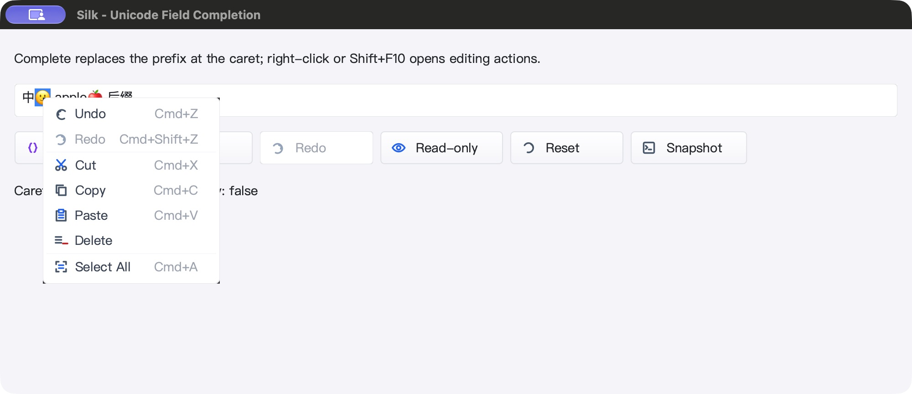

# SDK 字形回退与精确光标布局 QA — 2026-10-25

## 修复范围与旧问题证据

上一轮 SDK 截图里的 emoji 是占位字形，但 JSON 回读里的码点完整。
本轮先添加回归再改代码：`A中🙂B` 的旧光标宽度为 56.712，文本测量为 60.962；
重复 `im` 的第 2 个 rune 边界被点击命中为第 3 个边界。两项旧实现均失败，日志保留。

- `paint.LayoutText` / `TextLayout` / `GlyphRun` 保留每段字体及字形，不改变现有接口。
  原始 `TextToGlyphs` 契约不变，不能把不同字体的 glyph index 拼成单一字体绘制。
- `TextBlock` 每逻辑行只排版一次，视觉行切分／复用字体段；绘制不再重新 shape。
- 光标、命中、选区、滚动范围和输入法矩形统一使用浮点边界；不再借用 native glyph
  的 `A` 字段储存整数 advance，也不再用巨大宽度的空白字形模拟换行选择。
- 换行／内部哨兵只参与逻辑位置；末尾 CR 不再吞掉最终空白行。
- 自定义 ScaledFont 返回非一一 glyph/rune 时，使用有界逐 rune 兼容路径，而不是
  放弃整个文本块。返回布局持有字体副本，调用方修改原字体不会污染旧字形。

## 自动验证

`GOTOOLCHAIN=go1.26.10`，`GOMAXPROCS=2`，`SILK_TEST_FONT_FALLBACK=1`：

- paint、gui、ged、prop、cmd/silkide、三个 SDK 示例：
  `go test -race -short -json -count=1 -p 2`，含子测试 **5574 pass / 44 skip / 0 fail**。
- 根包 race-short、八包 vet、RequireBundle IDE 与 SDK 原生构建通过。
- 三项强制附带 gopls 集成：**3 pass / 0 skip**。
- 1／1.5／2 倍缩放下，保留字形绘制与独立文本回退路径逐像素相等；
  含实际字体覆盖断言、混合中文／emoji、换行切分、末尾 CR/CRLF、字体修改快照、
  自定义 glyph 数量、非法 UTF-8／NUL 显示边界、点击及 IME 光标几何。
- IME 项验证的是矩形计算，不是完整系统输入法候选窗口的原生交互认证。
- 冻结的 1675 个源码输入在构建／UI 验收后 SHA-256 回读一致。

## macOS 原生闭环

SDK 原生窗口（PID 49510）：

1. 初始文本 `中🙂 ap 后缀`；Complete → `中🙂 apple🍎 后缀`，光标 rune 9。
2. 按钮及 Cmd+Z／Cmd+Shift+Z 撤销重做；8 个 JSON 快照验证确切文本与编辑计数。
3. 在截图字形边界点击再 Shift+Right，选区精确为 `[1,2)`，仅选中 🙂。
4. 右键菜单保留该蓝色选区；菜单 Delete 只删 🙂，Undo 恢复字形及反向／正向选区。
5. Reset → Read-only，Complete／Undo／输入 Q 均不修改文本。
6. 截图确认 🙂 和 🍎 为实际彩色图形，不是仅字符串正确。

IDE 原生窗口（PID 51943）：

- 正文输入 X；Go-to-Line 输入 `3:2`，重复局部 Undo 不影响正文 X。
- Redo → Enter 后实际状态栏为第 3 行第 2 列；Save 读回精确为 X 加原始混合换行文本。
- 正文 Undo → Save 后逐字节恢复原始文件。附带 gopls 显示 connected。
- 两个精确 PID 均正常关闭，并使用 ps 确认退出。

## 性能采样（本地，不代表所有平台）

- 光标导航：约 54.6–55.0 ns/op，**0 B/op / 0 allocs/op**；导航不重新排版。
- 保留字形的输入框重绘：约 27.5–27.6 µs/op，872 B/op、14 allocs/op，**并非零分配重绘**。
- 32 KiB ASCII 消息框布局约 1.05–1.06 ms；3000 个混合 rune 窄行布局约 1.9 ms，
  30000 个约 21.4 ms，保持近线性但仍有较高分配，超长字段优化仍有空间。
- SDK 空闲 5.011 秒 CPU 增加 0.03 秒（约单核 0.60%）；IDE 5.018 秒增加 0.05 秒
  （约 1.00%）。仅 GUI 进程短采样，不含 gopls，不是整机或长期帧率保证。
- 没有新增计时器、轮询或 goroutine。

## 平台边界与后续

- **Windows 本轮没有通过结论。** 主地址 10.88.51.27 与备用地址 10.88.66.192
  均 SSH banner 超时，两次 scp 连接关闭；未启动本轮远端编译或交互式任务。
  已准备 398 个 overlay 输入及测试脚本，等待连接恢复后验证同一版源码。
- Linux 原生 UI 未测。简单 LTR/rune 布局不等于复杂脚本、bidi、组合字符或 ZWJ
  家庭 emoji 的完整 shaping；缺少系统字体时仍可能显示缺字。
- 菜单圆角黑色像素仍可见，明确留作后续独立修复；未把本轮字体修复表述为全部 UI 完成。
  后续已单独修复并验收 macOS 原生表面，见 [菜单表面 QA](POPUP_SURFACE_QA_20261025.md)；
  本文保留该轮截图和当时观察，不追溯改写旧测试结果。
- 没有 commit、push 或发布。

## 紧凑证据索引

目录：`bin/qa-artifacts/textblock-fallback-20261025/`

- `before-regression.log`、`focused.log`、`row-pixels.log`、`mac-race.jsonl`、`mac-test-summary.json`
- `mac-gates.exit` = 0；`mac-gates.log` marker `MAC_BUILD_RACE_GOPLS_OK`
- `mac-source-hashes.json`、`mac-bundled-gopls.log`、`mac-benchmark.log`
- `mac-sdk-ui-readback.json`、`mac-ide-ui-readback.json`、`ide-saved-after-query-undo.txt`
- `windows-connectivity.log`、`windows-alternate-connectivity.log`、`windows-retry.log`、`phase-status.json`
- SDK SHA-256：`ba2260133dc63462fb898c9c22a6414fe5f7842036672267216a72668faf64a5`
- IDE SHA-256：`21b8be24a16c586099bc892b05b8d2c2a6eea5552420d01c2a04d6d9d373454d`
