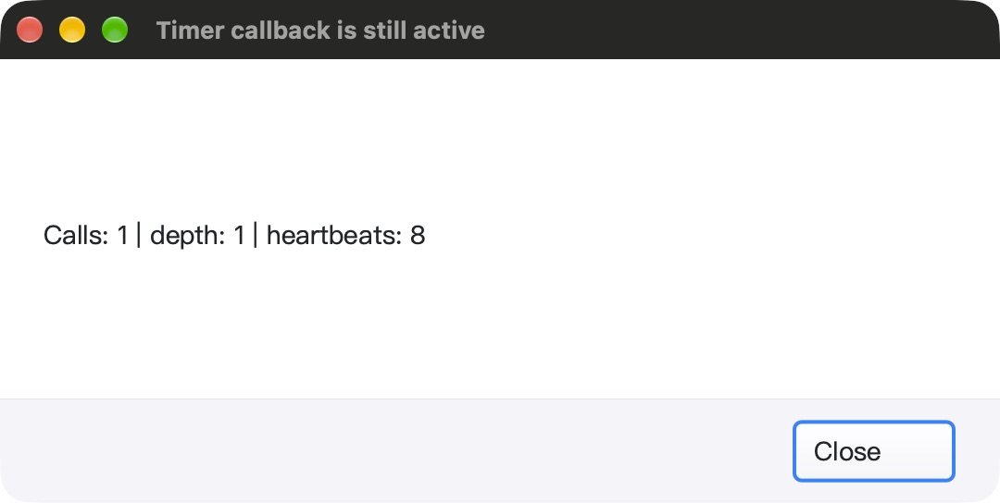
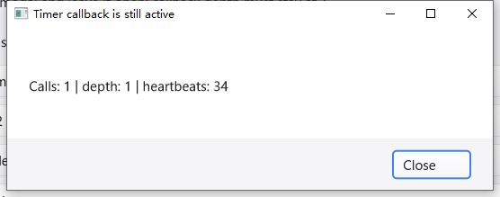
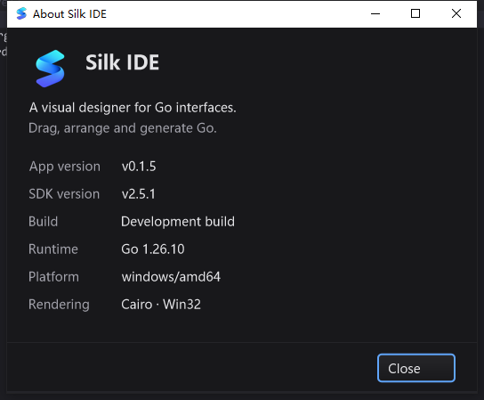

# 模态定时器与对话框按钮回归（2026-10-25）

本轮在前一轮编辑器指针焦点增量上继续修复 SDK 底层，不代表 Qt Creator 功能对齐完成。
保留工作树原有改动；没有 commit、push、打 tag 或发布。所有 UI 使用隔离配置和测试文件。

## 发现与修复

### 同一 GLFW 定时器在模态循环里重入

- 原有 `processTimers` 在调用回调前更新 `lastFire`，但没有记录回调仍在运行。
  回调打开 `ShowModal` 后，嵌套消息循环过了周期就再次调用同一个回调。
- 修复前的确定性测试实际失败：`calls=4 depth=2 sibling=4`。
  未修复 SDK 的真实 macOS 弹窗也出现深度 2、调用次数持续增长；不是仅凭源码推断。
- 每个启用记录增加 `running`，收集及派发两处均跳过已运行记录；回调返回／panic 时
  清理捕获的原记录。Stop/Start 后不会误清理替代记录；兄弟定时器不被全局阻塞。
- 不新增 goroutine、轮询定时器或绘制任务。Windows 同 ID 防重入实现保持不变，
  此轮仅新增跨平台回归，不声称解决原生定时器 ID 复用问题。

### 先设置尺寸、后添加按钮导致 footer 按钮消失

- `Dialog.AddButton` 调用外层 Layout，但若 footer bounds 与上次相同，`SetBounds`
  不触发 OnResize，新增按钮没被排版，实际 bounds 为 `[0 0 0 0]`。
- 修复前测试直接记录该零尺寸；SDK 原生弹窗截图显示底部空白，没有 Close 按钮。
- `Dialog.Layout` 显式调用按钮容器 Layout；新增第二个按钮、同尺寸重复布局也保持
  最小按钮尺寸、按钮间距和右侧 24 逻辑像素内边距。
- 这是布局失效修复，不是新增浮层、遮盖补丁或调整窗口透明度。

### 新 SDK 示例

`examples/timer-lifecycle` 使用公开 SDK API，提供：

- 周期回调打开模态窗口；独立 100ms 心跳证明兄弟定时器仍能运行。
- 可重启两秒延迟，只执行最后一次启用的回调；取消后不执行。
- 鼠标、Enter、Escape 关闭和 JSON 状态快照；退出时停止示例定时器。
- 零尺寸、小尺寸布局边界检查。该示例不是新的后台调度服务，也不是实时调度保证。

## 自动测试

| 范围 | 结果 |
|---|---|
| macOS 11 包 `go test -race -short -count=1` | 5,636 pass / 47 skip / 0 fail |
| macOS Timer / Modal / Dialog 定向 race，3 次 | gui 与新示例通过 |
| macOS 根包 race、11 包 vet、IDE/SDK 构建 | 通过；vet 无输出 |
| macOS 强制 native cursor / GL / backbuffer | 5 项通过 |
| Windows 10 真机，7 包定向 race，3 次 | 通过 |
| Windows 真机 gui 全包 race-short | 2,727 pass / 21 skip / 0 fail |
| Windows gui / win32 vet | 15 条既有诊断，与前一阶段实跑基线相同；0 新增，**不是 clean vet** |

新增 6 个测试：同启用重入、panic 后恢复、回调内停止再重启、晚添加 footer 按钮、
示例延迟取消、示例极小布局。测试名称和全部原始输出保留在证据目录。

## 原生桌面闭环

### macOS arm64

- SDK 修复前／后独立构建、独立配置。最终产物真实打开三次模态窗口，分别鼠标、
  Enter、Escape 关闭。每次 `ModalCalls=1`、`MaxDepth=1`；兄弟心跳分别推进
  398 / 222 / 168 次，回到主窗口 Snapshot 确认 `Depth=0`。
- 连续重启 generation 1、2，只触发 generation 2 一次；generation 3 取消后不触发。
  17 条原始 JSON 快照与回读逐项验证，不以截图或工具成功代替断言。
- IDE 真实 Help → About → 鼠标 Close，直接输入 T → 工具栏保存 → 直接输入 R；
  文件精确为 `TR` + 原 UTF-8／混合换行内容，双 Undo 恢复原字节。
- 拖动 unsafe.txt 页签到第一位后直接输入 D → 工具栏保存 → 直接输入 E；
  实际文件为 `DE` + 原字节，随后撤销恢复。没有靠额外正文点击掩盖焦点丢失。
- 所有本轮 Mac SDK／IDE／修复前示例均正常退出，终端再次确认 PID 不存在及 SHA 不变。

### Windows 10 22H2 amd64

- 在交互桌面 session 1 测试，不在 SSH session 0 注入鼠标。
  每次操作验证 PID、可执行路径、SHA-256、前台／像素所属窗口。
- SDK 模态窗口的 Close 可见、可点击；鼠标、Enter、Escape 三条路径均回到主窗口。
  每次回调次数／深度为 1；心跳分别 800 / 16 / 14，延迟重启／取消状态与 Mac 相同。
- IDE About 通过真实 Help 菜单打开，Enter 关闭后无需重聚焦直接输入、工具栏保存、
  继续输入；文件精确为 `YZ` + 原内容，双 Undo 恢复。
- 编辑器回归：键盘切页／返回、页签原生拖拽后直接输入、工具栏保存后继续输入、
  实际 Edit 菜单 Select All → Q → Undo、实际 Go to Line → `2:3` → Enter → 输入。
  Unicode、混合换行与原字节恢复均有文件回读，不以菜单截图代替功能结论。
- Windows 两个 IDE 会话日志确认启动 bundled gopls v0.24.0、ready 并正常 shutdown；
  这仅证明随包服务启动链路，不等同于再次覆盖所有 LSP 命令。
- Dock 选择器、边框真实拖动缩放、短时空闲采样和正常关闭；任务的 Ready / 结果 0
  与成功 marker、终态文件、进程关闭、源码／二进制哈希一并检查。

## 短时性能观察与范围

- macOS SDK 无活动示例定时器时约 5 秒累计 CPU 0.04 秒；IDE 约 5 秒 0.04 秒。
  模态心跳刻意每 100ms 更新时约 5 秒 CPU 0.11 秒。
- 以上只是固定场景短时采样，不是长期基准、帧率测量或所有硬件的性能保证。
  Windows SDK 空闲约 5 秒 CPU 0.09375 秒，IDE 空闲约 5 秒 0.046875 秒；
  模态心跳约 3 秒 CPU 0.046875 秒，各采样 Responding=true。原始记录位于
  `ui-evidence/*idle.json` 和 `sdk-modal-cpu.json`；不将 race 测试或进程存活
  等同于不卡顿保证。
- Linux 原生桌面、Windows 高 DPI／多显示器尚未验证。UI Timer 仍只允许 UI 线程
  调用；后台业务必须 `gui.Post`。耗时回调仍会占用 UI 线程，修复不提供抢占。
- 修复前 Mac 观察窗口后曾再次进入弹窗，未建立额外触发原因；后修复的一次截图
  API 返回零尺寸错误，原 PID 始终存活、状态仍为 modal open，同一句柄重取截图成功。
  保留这些观测，不把它们冒充已定位的新框架缺陷或声称全部平台问题已解决。

## 可复核证据

主目录：`bin/qa-artifacts/timer-lifecycle-20261025/`（本地 QA 产物，默认不入库）。

- `before-source/`、`before-regression.log`、`dialog-order.log`、`before-modal.png`：修复前失败。
- `phase-source.diff`、`source-hashes.json`：本阶段 6 个源码文件差异，1,723 个源码／构建输入。
- `mac-source-hashes.json`、`overlay-hashes.json`：Mac 1,710 输入，Windows 457 个增量覆盖。
  Windows 基线 1,801 个文件验证未修改；新示例包的空目录仅供 Go overlay/vet 使用，完成后移除。
- `mac-gates.sh`、`mac-race.jsonl`、`native-gl-race.log`、`after-focused-final.log`。
- `windows-evidence/evidence/`：构建、7 包定向测试、完整 gui JSON、vet 基线比较和终态回读。
  Go JSON 经 cmd 原始重定向保存，避免 PowerShell 5 转码破坏 Unicode。
- `mac-ide-*.bin`、`sdk.stdout`、`windows-evidence/ui-evidence/`：真实输入／保存／快照。
- Windows 每项 UI 任务使用独立 `timer-*.ps1` 文件名，避免覆盖前一阶段已注册任务的脚本。
- `verify-final.py`、`deliverable-hashes.json`、`final-artifact-readback.json`：源码、测试计数、
  PID、二进制、17+17 快照、真实文件与交付物的本地复验。

复核命令：

```sh
python3 bin/qa-artifacts/timer-lifecycle-20261025/verify-final.py
go run ./examples/timer-lifecycle
```

### 截图






