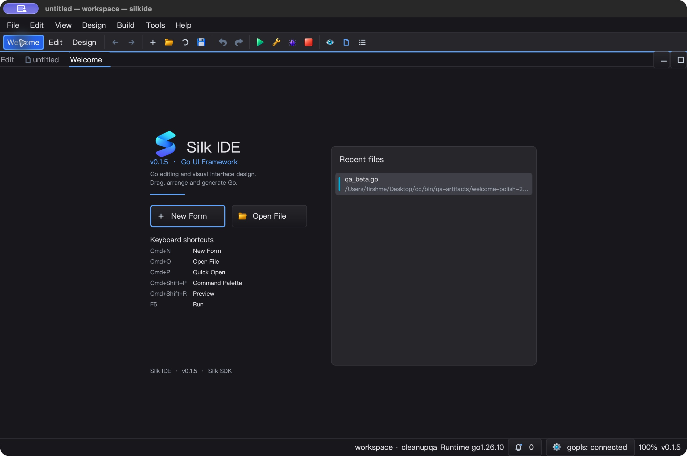

# Welcome UI 与原生输入迭代（2026-10-25）

这是分批迭代，不是 Qt Creator 全功能对齐或整个工作区 UI 已全部完成。
输入作用域的独立根因和双平台回归见 [输入回归](INPUT_ROUTING_QA_20261025.md)。

## 本批实现

- Welcome 从纯画布按钮改为真正的 SDK Button/ListWidget 子控件。鼠标、Tab、
  Enter/Space、列表方向键/Home/End/PageUp/PageDown 共用实际回调；没有回调时禁用。
- 自适应双栏／单栏，按钮必要时纵排；短窗口整页滚动，长最近文件列表独立滚动。
  焦点滚入可见区域只跟随选中行，不因点击列表而把整张卡片移走。
- 文件名与目录两行显示，按实际字体宽度进行 Unicode 安全省略；完整路径 tooltip，
  列表只绘制可见行；SDK 不限制传入项数，IDE 保留原有 10 条 MRU 策略。空列表没有不可见的交互层盖住提示。
- 空白处、拖出释放、没有对应按下事件的释放不打开上次选择的文件；自动重复的
  Enter/Space 不反复打开。MRU 刷新取消尚未完成的按下，避免打开被替换的新条目。
- 浅／深色、中／英文、14/20/28 字号布局回归。缓存字体，只有尺寸／字体／语言／
  数据变更触发布局，不加入 timer、goroutine 或后台轮询。
- `SetActionLabels` 和 `SetShortcuts([]WelcomeShortcut)` 允许宿主提供真实命令信息。
  SilkIDE 显示 **New Form**（实际创建窗体），使用平台 Cmd/Ctrl、Quick Open、
  Command Palette、Shift+R Preview 和 F5 Run，去掉过时的固定控件数量宣传。
- 保留宿主 logo 与 SDK 默认品牌隔离，实际像素品牌测试继续通过。

## 失败基线与回归过程

原版本在 400×600 时两个动作按钮覆盖最近文件行；传入切片可被调用方修改并改变
打开目标；空 hit rectangle 也接受原点点击。失败日志保留在本轮 QA 目录。

实机首次验收发现 SDK 有图标的 Button 默认不显示文字；已显式启用文字并增加
断言。MRU 按下后刷新再释放的回归也先失败，补上按下状态重置后通过。
第一次测试矩阵要求 200 px 宽窗口在 28 字号下仍完整容纳按钮文字，这是无法保证的
夹具约束；调整为 400 px 及以上必须满足按钮测量宽度，极小窗口仍测试非负尺寸、
无重叠、合法几何。不是通过放松正常窗口布局要求来掩盖覆盖。

## macOS 原生 UI

- 独立 SDK 窗口：New、Tab/Open、Tab/End/Enter 返回精确 `file-29.silkui`；
  窄窗点击第 22 项返回第 22 项，不因焦点滚动跳错行；随后 End 返回第 29 项。
- 460 px 窄窗、中文、深色、20 字号实机截图；末项仍可通过 Tab/End/Enter 打开。
  恢复默认字体和宽窗口后无旧页面滚动残留；空状态提示可见。
- 真实 IDE：Welcome 新建进入 Design；Open File 弹出原生面板，选中并打开精确的
  `qa_beta.go`；回 Welcome 后 MRU 同步，单击该项回到 82 字符的 QaBeta 文件。
- 原生 Go To 面板首次 `paste` 未得到请求路径，而保留了上一次 QA 路径；并未把
  那次打开当作目标验收。重试使用 AX `setValue` → 读回完整路径 → 读回选中项 →
  Open，才确认目标。该步骤属于自动化输入限制，不据此修改编辑器缓冲区。
- 首次 UI 验收构建（最终按下状态重置前）中，SDK 探针 5.01 秒空闲采样约单核
  0.60%，IDE 主进程 5.01 秒约 1.00%，不含 gopls CPU。短采样不代表长期性能保证。
  最终构建再次读回 6 份 workspace 文件逐字节不变，原生退出后主进程已退出。

## 自动化／Windows 验证

- macOS arm64 / Go 1.26.10：`go test -race -short -count=1 -p 2 ./gui ./ged ./cmd/silkide`
  最终 4,770 通过、42 跳过、0 失败（含子测试）；3 包通过。`go vet -composites=false`
  与 RequireBundle 原生构建通过，1,651 项代码与构建脚本输入回读无漂移。
  独立设计器根包 `go test -race -short -count=1 .` 与 `go build .` 也通过（不计入上述 3 包数量）。
- 在 MRU 按下状态重置后重新构建、重跑完整 macOS gate，真实 IDE 再次验证
  Quick Open、原生 Open、MRU 单击与 New Form，最终二进制 SHA-256：
  `36580b5fd66f7a24b4f57ac41876f4a901b566c8b24774ffed3162b8cadad1d9`。
- Windows 10 amd64 / Go 1.26.10 / CGO：相同 3 包最终 `-race -short -count=1`
  4,648 通过、65 跳过、0 失败（含子测试）。原生 IDE/SDK 探针构建、工具包清单验证、
  3 项强制内置 gopls 集成回归通过，gopls 无跳过。
- Windows 334 项覆盖文件的远端回读哈希与本地相符，1,651 项代码与构建脚本输入
  没有未覆盖差异；Windows 桌面交互验收另列，自动化通过不替代 UI 验收。

## Windows 10 桌面交互验收

- 最终源码构建的 SDK 探针：点击 New、Tab/Enter Open、Tab/End/Enter 打开第 30 项；
  窄窗重做同一条链路仍返回精确 `file-29.silkui`。中文／深色／20 字号、恢复默认
  字体与宽窗口、空状态均有真实桌面截图。
- 最终原生 SilkIDE：点击 New Form 后截图明确显示 Design 模式；Open File 打开
  原生选择器并输入 QA 路径；两次复制编辑器内容均与 `qa_beta.go` 一致，第二次
  经 Welcome MRU 单击进入。600×760 窄窗单栏截图没有按钮覆盖列表。
- 6 个工作区文件的前后哈希一致；确认实际 gopls 是本构建旁的 `apps\tools\gopls.exe`
  子进程。4 个交互任务均有成功标记、终态 Ready、LastTaskResult=0。
- 最终 IDE 主进程空闲 5.008 秒 CPU 增量 0.078125 秒，约单核 1.56%；SDK 探针
  5.014 秒增量 0.015625 秒，约 0.31%。不含 gopls，不作与旧版本的性能提升对比。
  正常 Alt+F4 退出后，IDE、gopls 与探针均无遗留进程。
- 第一次探针启动检查误用了 .NET `MainWindowHandle`：实际拥有可见的 QA 窗口，
  但该属性返回 0，进程同时还有隐藏控制台。通过按 PID+完整窗口标题枚举 HWND
  找到正确窗口，保留检查失败记录，修正测试脚本后完成验证，未修改 SDK 来规避。

## 后续队列与验证边界

- 实机发现 Quick Open 没有像原生 Open 一样更新 Welcome MRU，已记录为后续宿主
  打开入口统一的问题；本轮只验收原生 Open 的 MRU 链路。
- 此轮发现设计器控件面板 Rating 图标占位可能侵入标签、英文模式部分布局／属性
  标签仍为中文；已保存真实截图，后续针对控件面板和设计器工具栏继续修复。
- 最近文件选中态的次级路径文字尚未做完整无障碍对比度矩阵；不声称满足全部
  WCAG 要求。
- 并未声称所有菜单、弹窗、布局和控件均已完成打磨；SDK 通用祖先检查的其它
  调用路径仍待审计。
- 独立设计器的完整原生 UI／全局快捷键链路本批未验收，SDK 的提示不自动注册
  快捷键；自定义宿主应使用 `SetShortcuts` 描述自己的实际绑定。
- 未覆盖 Linux 原生桌面、Windows 多显示器 DPI 切换、完整 IME 或长时压力测试。
  字体缩放矩阵不等价于系统 DPI 兼容性测试。

## 重放与证据

`bin/qa-artifacts/welcome-polish-20261025/`（忽略的 QA 产物）：
- `probe.go`、`ui-*.ps1`、`launch-native.py`：真实控件探针与平台交互步骤。
- `baseline.log`、`overlap-baseline.log`、`mru-refresh-baseline.log`：失败基线。
- `mac-*.png`、`mac-probe-final.jsonl`：原生截图与精确动作目标日志。
- `mac-race.jsonl`、`mac-vet.log`、`overlay-hashes.json`：测试与源码映射。

文档截图只采用应用窗口，不发布桌面其它程序或原生文件选择器的无关目录内容。

MRU、控件图标边界及局部本地化的后续修复已在 [设计器细节回归](DESIGNER_DETAILS_QA_20261025.md) 验证；上文发现列表保留为当时快照。
