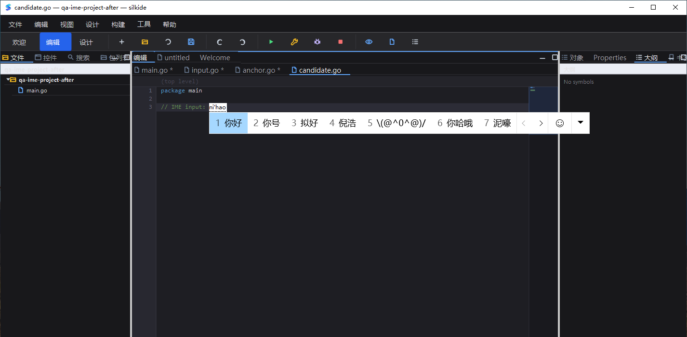

# Windows 输入链路迭代（2026-10-20，PDT）

基线为已提交并推送的 `9ce1d0fa02afb42373091e71f0df417b06c8969a`。本文件记录该基线后的输入链路迭代；提交前复核见末尾。

## 复现与修复

- 真实 Win10 桌面：在编辑器第 6 行键入拼音 `nihao`，旧程序把组合窗放到主窗口左上角、候选列表覆盖菜单；新程序在插入光标处显示组合窗，候选列表位于文字下方。
- 原 `WM_CHAR` 每条消息单独转 UTF-16，遇到高代理项就插入替换字符。新增小型状态解码器，只缓存未完成的高代理项；配对后一次提交一个 Unicode 字符。孤立代理项丢弃，焦点切换、失去原生焦点和控制字符断开旧序列，避免跨输入框拼接。
- 实现 `WM_UNICHAR` 能力探测及 UTF-32 标量输入，拒绝 surrogate/超范围标量。字符事件使用当前窗口的合法逻辑焦点路由，不再把其他 Form 的消息写进全局聚焦框；保留自有非激活 popup 的键盘路由。
- 新增可选 `IInputMethodCursor.InputMethodCursorRect()`：代码编辑器、普通 Edit、SearchBox 按各自光标/滚动几何提供位置；嵌套控件的坐标转换到接收 HWND 的客户区，小尺寸和空布局有界处理。
- 原生 `WM_IME_STARTCOMPOSITION`、`WM_IME_COMPOSITION`、激活/候选通知驱动位置更新，使用 `CFS_POINT` 和 `CFS_EXCLUDE`；候选通知按位掩码处理 0～3 号列表。无新增空闲任务/绘制定时器。
- 继续由系统负责 preedit、候选选择和结果提交，不另读 `GCS_RESULTSTR` 造成重复插入；`ImmGetContext` / `ImmReleaseContext` 成对调用，并保护同步 IME 通知的重入。

API 契约依据 Microsoft 的 [COMPOSITIONFORM](https://learn.microsoft.com/en-us/windows/win32/api/imm/ns-imm-compositionform)、[CANDIDATEFORM](https://learn.microsoft.com/en-us/windows/win32/api/imm/ns-imm-candidateform)、[ImmGetContext](https://learn.microsoft.com/en-us/windows/win32/api/imm/nf-imm-immgetcontext) 和 [WM_UNICHAR](https://learn.microsoft.com/en-us/windows/win32/inputdev/wm-unichar)。

## 真实桌面闭环

Claude `win10testcomputer`，Windows 10 22H2 / Go 1.26.5 / Cairo 1.18.4。Session 0 只运行编译/自动回归；计划任务进入 Session 1，使用新建隔离设置和工程，不复用用户标签或更改持久化 PATH。

1. 原始程序 `silkide-after.exe`（上轮最终 SHA-256 `AC38703A…D406F5`）截图复现左上角候选窗。
2. 修复程序 `silkide-input.exe`，相同窗口尺寸和输入操作，截图显示候选窗跟随光标。另在输入后移动的插入点触发第二次组合，候选位置随之变化。
3. **同一个桌面任务内**连续输入 `nihao`、空格选择、Ctrl+S，磁盘严格断言 `你好` 出现一次，没有未提交的 `nihao`。
4. 切回英文布局后用 `Send-Keys` 输入 `🚀𠀀`，再次保存，UTF-8 回读为 `// IME input: 你好 🚀𠀀`，无 U+FFFD。不是通过剪贴板绕过字符消息，也不是只对编辑器模型赋值。
5. 再输入 `ceshi` 后 Esc 取消、保存，要求磁盘全文与组合前完全相同。
6. 完成后 Save All 并正常关闭本轮 QA 进程，未强杀、未关闭其他应用。
7. 公开图片只截取本应用上部 `(7,0,1426,700)` 区域，不包含右下角其他应用的置顶内容；未关闭/修改该应用。



图片只证明候选定位，不证明所有脚本字形覆盖。图中为系统原生 IME，非模拟或重绘。

### 保留的失败与边界

第一次把“输入拼音”和“选择候选”拆成两个计划任务，后续读到了 `ni'hao` 而不是 `你好`，该次**未通过**；不能把之前截图里有候选列表当成提交成功。同任务连续操作通过，跨任务/焦点生命周期对组合提交策略的影响尚未进一步定因，失败日志和文件不覆盖。

回读正确的 `你好 🚀𠀀` 在 Windows 默认代码字体中仍显示缺字框：CJK/emoji 字体 fallback 是另一个真实缺口，不能用本轮编码修复冒充字形渲染修复。字体回退需要同时统一测量、命中测试和绘制，不能只替换成比例字体破坏代码对齐。

本轮仍捕获到 `ui: event loop resumed after 6.707s`，未归因或修复启动/首次交互阻塞；不发布整体启动/输入延迟或 CPU 提升数字。未新增 Linux 桌面、macOS 原生 IME、第三方输入法、TSF 文本服务、重转换或混合 DPI 验收。

## 自动回归与可重放证据

- Windows 原生消息回归：高代理项不提前提交、完整 surrogate pair、WM_UNICHAR 能力探测、非法输入、嵌套字段、禁用字段、跨 Form 路由、A→B→A 焦点变化及失焦清空。
- Windows Session 1 的真实 IMM context：读回 OS COMPOSITIONFORM/CANDIDATEFORM，验证代码光标、嵌套搜索框偏移、多候选列表，以及重复 100 次位置更新。旧入口失败，新入口通过；不是 mock setter。无交互桌面的 Session 0 可跳过 IMM context 用例，**跳过不算通过**；Session 1 必须设置 `SILK_TEST_NATIVE_IME=1`，此时拿不到 context 即失败。
- 跨平台测试覆盖 UTF-16 序列、小尺寸/无效几何、搜索框尚未绘制时的滚动光标；Win32 ABI 验证 IMM 结构尺寸/偏移。API 转发检查由 192 扩展到 196 项。
- macOS 六包非 short 回归：3,797 pass / 5 skip / 0 fail，另有 targeted race。默认 `go vet` 报告既有 unkeyed literal 警告，与 `9ce1d0f` 隔离基线输出完全相同；`go vet -composites=false ./gui ./cmd/silkide` 通过，未把默认 vet 描述为全绿。
- `win32` 测试程序 Windows 386/ARM64 交叉编译通过，只证明该纯 Go 绑定包可编译，不代替 GUI/Cairo 运行。

Windows 最终十二包非 short 回归为 **4,608 pass / 39 skip / 0 fail**，12 包均通过；原始 JSONL 为 `windows-all.jsonl`。其中 IMM context 在 Session 0 跳过，最终 Session 1 以必需模式单独通过（`native-after-session1-final.log`）。macOS 六包和 Windows 十二包 stderr 均为空。

```text
Windows 交互测试二进制 SHA-256
69AAAC87E7202D4F6904EBE0EFFED0BED27C11F7D34E12394C90E7A58C65A71F
隔离 macOS 构建 SHA-256（未替换已安装 App）
8c6ac4f5f36c30c945607a2e89f761718f7b1ee17137a8f44f4a5d7197bbcc02
基线提交 / 远端 main 回读
9ce1d0fa02afb42373091e71f0df417b06c8969a
```

原始证据在忽略目录 `bin/qa-artifacts/iteration-20261020-input/`：
`input-before.log`、`native-before-session1.log`、`native-after-session1-final.log`、`windows-all.jsonl`、`local-all.jsonl`、`commit-input.log`（初次失败）、`commit-same-task.log`（通过）、`ime-committed.go.txt`、`source-manifest.json` / `source-remote.json`、`baseline-vet.log` / `local-vet.log` / `vet-delta.diff`，以及计划任务脚本和前后截图。10 个新增/修改 Go 文件逐文件哈希与 Windows 测试源一致。CI 已追加输入回归入口；本地验收不等同于远端 GitHub Actions 已通过。

## 提交前复核

提交前再次使用 `-count=1` 禁用测试结果缓存，证据保留在上述目录的 `commit-verification/`：

- macOS `./cairo ./paint ./gui ./prop ./ged ./cmd/silkide`：**3,797 pass / 5 skip / 0 fail**，6 包均通过。
- Windows `./gui ./win32`：**1,851 pass / 2 skip / 0 fail**，2 包均通过；这是提交前专项复测，不冒充再次运行十二包全量回归。两平台测试 stderr 均为空。
- 重新编译 Windows 测试程序，在 Session 1 设置 `SILK_TEST_NATIVE_IME=1` 运行 `TestWindowsIMEPositionsAtEditorCaret`：**PASS / EXIT=0**，没有把 Session 0 的跳过算作原生 IME 验收。
- `go test -race -count=1 -run 'Test(UTF16TextInput|InputMethod|CodeEditorDocument)' ./gui` 与 `go vet -composites=false ./gui ./cmd/silkide` 通过；默认 vet 的既有警告边界不变。
- 10 个 Go 文件再次与先前实机测试清单、Windows 测试机源码逐文件 SHA-256 对齐；`gofmt`、工作流 YAML 解析、`git diff --check` 通过。公开截图与此前核验的应用区域截图字节一致。
