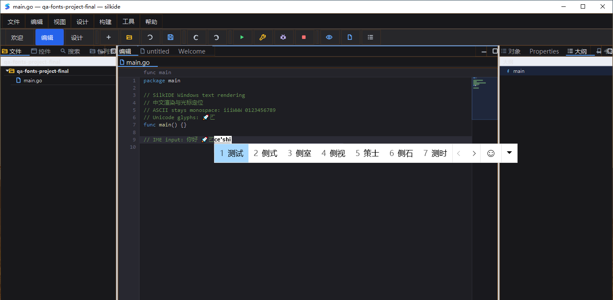

# Windows 字体回退与原生模态诊断（2026-10-20，PDT）

基线：`4687e2660103cc7aeafe4e2b9889ebb42b574eb4`。本轮不改动用户设置、安装路径、默认字体或持久化 PATH；Windows 在隔离源码、工程和设置目录验收。

## 字体根因与修复

原来 `paint.Font.TextExtents` 与 `Painter.DrawText/DrawText1` 只使用单个 Cairo font face。Consolas 保留英文等宽，但不覆盖本轮测试的中文、emoji 和扩展 B 汉字；字符保存正确并不能证明字形已经显示。Cairo 的 [toy text API 说明](https://www.cairographics.org/manual/cairo-text.html) 明确不提供完整字体回退/复杂文字布局。

新增 Windows 原生 Cairo 的简单 LTR 字体分段：实际检查 glyph coverage，仅对缺字选择系统字体。测试机实际命中：`你好 → Microsoft YaHei UI`、`🚀 → Segoe UI Emoji`、`𠀀 → SimSun-ExtB`。测量与绘制复用同一个分段器；保留字号、粗斜体、CTM，字体分段完成后恢复 painter 的原始字体。字符组合标记、variation selector 和 joiner 不被独立拆到其他字体；私用区 icon 码位不替换成无关字体的图标。

英文仍使用原来的字体和 glyph buffer 路径。绘制先检查已有 glyph，已覆盖的中文菜单/图标不额外做回退字体选择或重复测量。每个 scaled font 的 coverage cache 限制为 2,048 项，包含失败结果；不添加定时器、字体目录扫描或外部 DLL 依赖。

### 独立失败复现

`gui/text_fallback_windows_test.go` 可原样运行于基线，不依赖新实现的内部函数。Windows `-count=1` 实测：

- 旧版 `A你好B` advance = **35.1875 px**；实际字体分段期望 **49.59375 px**，测试失败。
- 修复后同一用例通过；同时验证 CodeEditor 光标、IME 光标矩形和鼠标命中位置。
- 原生字体专项：100% / 150% / 200% 变换下，与分别调用原生单字体 glyph 绘制的参照图逐字节一致；另覆盖 ASCII、连续中文合并、组合标记不拆分、前后空格的 ink bounds、未知字形的失败缓存、cache 上限和粗斜体。

这是渲染矩阵的缩放测试，不等同于真实显示器 DPI 切换。

## 原生文件对话框不再误报 UI 阻塞

基线真实 Session 1 对照：干净工程窗口 ready 1,990 ms，静置 12 秒消耗 0.078125 CPU 秒并保持 Responding；随后将“打开文件”窗口保持 8 秒，watchdog 报出 `event loop has not run for 5.678s` 和 `resumed after 9.679s`。完整 goroutine 栈显示主线程停在 `win32.GetOpenFileName → gui.OpenFileDialog`，不是证实了编辑器启动死锁。

`OpenFileDialog` / `SaveFileDialog` 现在使用显式 native wait scope；支持嵌套并以 defer 平衡异常路径，退出时刷新 heartbeat。只有已知系统模态调用暂停该检测，普通 UI 回调仍保持 5 秒阈值。恢复耗时使用实际 heartbeat 而不是下一次 watcher 采样时刻。测试模拟了嵌套、panic、原生等待忽略以及等待之外真正阻塞仍被识别。

旧输入 QA 中的 6.707 秒告警没有对应的当时堆栈，**不能追溯断言它一定同因**。本次对照只证明原生文件选择器这一类误报；不声称总体启动、首次输入或所有 native modal 内部卡顿已修复。

## 真实桌面闭环

Claude `win10testcomputer`，Windows 10 22H2 / Go 1.26.5 / Cairo 1.18.4，真实 Session 1；无额外测试 PATH，未启动 gopls/dlv。

1. 隔离工程打开包含中文注释、ASCII 和 `🚀𠀀` 的 Go 文件，Open 对话框保持 8 秒再选择文件。
2. 同一桌面任务内键入 `nihao`、空格选择、Ctrl+S，UTF-8 回读严格检查 `你好` 出现一次且无原始拼音；切换英文布局后用 Send-Keys 输入 `🚀𠀀` 并保存，无 U+FFFD。
3. 代码区截图确认中文、rocket 和 Ext-B 字形可见，不再仅以文件内容代替绘制结果；在这些文字之后再次输入 `ceshi`，系统候选窗跟随新的光标位置。
4. Esc 取消组合后保存，磁盘全文不变。Ctrl+Shift+S 实际绑定是 **Save All**，不是 Save As；回读文本不变。未把快捷键发出当作原生 Save As 验收。
5. debug 模式下整个 Open 等待、输入/保存/取消过程中，无 `ui: event loop` 误报或 goroutine dump。最后正常关闭 QA 进程。



图片只捕获本应用上部 700 px，不包含或操作其他应用。第一轮脚本把 Go 保存后的末尾换行当作输入不匹配，原始失败保留；UTF-8 回读证明 `你好 🚀𠀀` 完整存在。最终检查仅归一化末尾 CR/LF，再从全新工程/设置重新走上述闭环，而不是跳过字符验证。

最终窗口 ready 3,872 ms，脚本静置 12 秒采样消耗 0.234375 CPU 秒且 Responding；前一次新构建曾为 6,066 ms。启动有波动，这些不是受控启动性能 A/B，不发布提速倍数。

## 最终自动回归与身份核验

- Windows 原生构建，13 个明确包，`-p 1 -count=1 -json`：**4,622 pass / 39 skip / 0 fail**，13 包均通过；包含真实生成 Grid/Form 程序的运行和 resize 回归，未使用 short 跳过。字体用例启用必需 coverage 模式。
- macOS 七包，`-count=1 -json`：**3,802 pass / 5 skip / 0 fail**，7 包均通过。两组原始测试 stderr 均为空。
- Session 0 跳过的原生 IMM context 验收，在 Session 1 以 `SILK_TEST_NATIVE_IME=1` 重新运行 `TestWindowsIMEPositionsAtEditorCaret`，**PASS / EXIT=0**。
- 本地 targeted race、`go vet -composites=false ./cairo ./purecairo ./paint ./gui ./cmd/silkide`、macOS 隔离构建、gofmt、工作流 YAML 解析和 `git diff --check` 通过。未替换已安装的 macOS App。
- 12 个新增/修改 Go 文件与 Windows 测试机逐文件 SHA-256 一致，并在实机闭环后确认本地源码未漂移。公开截图与已目视核验的原始应用区域截图字节一致。
- 混合中文测宽热缓存专项 `BenchmarkWindowsTextFallbackWarm`：单次实测 **13,174 ns/op / 560 B/op / 10 allocs/op**。回退并非零开销；该数据不是整体 UI 提速倍数，也不是完成了中文长行测宽优化。ASCII glyph-buffer allocation 回归另行通过。

```text
Windows GUI SHA-256
663B9054E4317E670EB2304E531336BC4BAF7575DD1E028C9124CD5E6361CDDE
macOS 隔离构建 SHA-256
fe53fce1fb296bcd618574aa27968afaeb34ecfebe6c633c5d856735d085c4a6
```

## 验收边界

- Windows 原生字体回退依赖已安装的字体；找不到字形时保留原字体的 missing glyph，不伪造字体安装成功。实机测试设置 `SILK_TEST_FONT_FALLBACK=1`，缺少所需 CJK/emoji/Ext-B coverage 即失败。CI 可以明确报告可选字体缺失的 skip。
- 这是简单 LTR 分段，不是完整 Pango/DirectWrite shaping；未认证 bidi、复杂脚本、emoji ZWJ 合字或彩色 emoji。低级 `TextToGlyphs/DrawGlyphs` 继续遵守单字体 glyph-index 契约；直接依赖它的富文本路径不是本轮回退覆盖范围。
- macOS/Linux 原生字体选择及 `silk_pure_go` 字体发现保持原有行为；没有新增 Linux 桌面或混合 DPI 实机验收。
- `CGO_ENABLED=0 go test -tags silk_pure_go ./cairo ./purecairo ./paint` **在本轮字体检查时未全绿**（后续修复见 [竞争与渲染 QA](RACE_RENDER_QA_20261020.md)）。与隔离的 `4687e26` 基线失败测试集合完全一致：虚线、部分图标精确色彩/路径保存和字体 allocation 门槛等 26 个失败记录（含父项/子项）。这是另一个后端的既有缺口，不能算成通过。
- 默认 vet 的既有 unkeyed literal 警告边界不变；仅将 `go vet -composites=false` 结果单独报告。未将本地验证写成 GitHub Actions 已运行。

## 证据位置

忽略目录 `bin/qa-artifacts/iteration-20261020-fonts/` 保留基线与修复源码哈希、JSONL、实机脚本、原始截图、stdout/stderr、失败尝试，以及 `purego-baseline/` 的隔离提交导出。关键入口为 `baseline-font-test.log`、`startup-probe.stderr`、`source-manifest-final.json` / `source-remote-final.json`、`final-ui/`、`final-tests/`、`macos-all-final.jsonl`、`native-ime-final.log`、`final-test-summary.json`、`pure-go-baseline-comparison.json`。原始源码与派生产物分开保留；无关的 `gen_image/` 和根目录 `silkide` 未修改。
