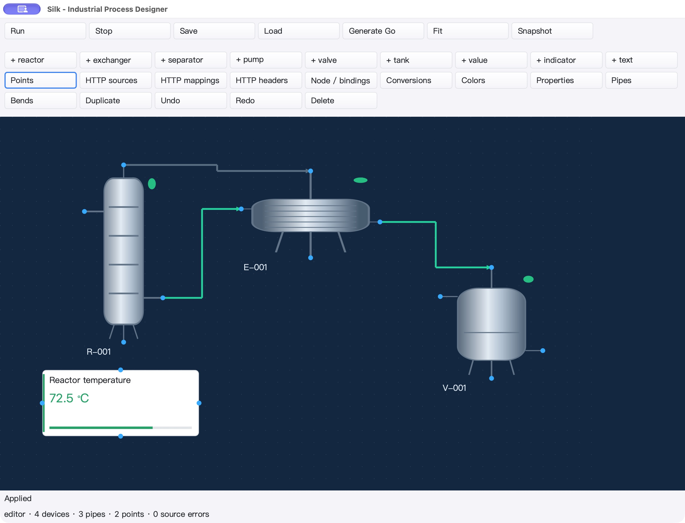
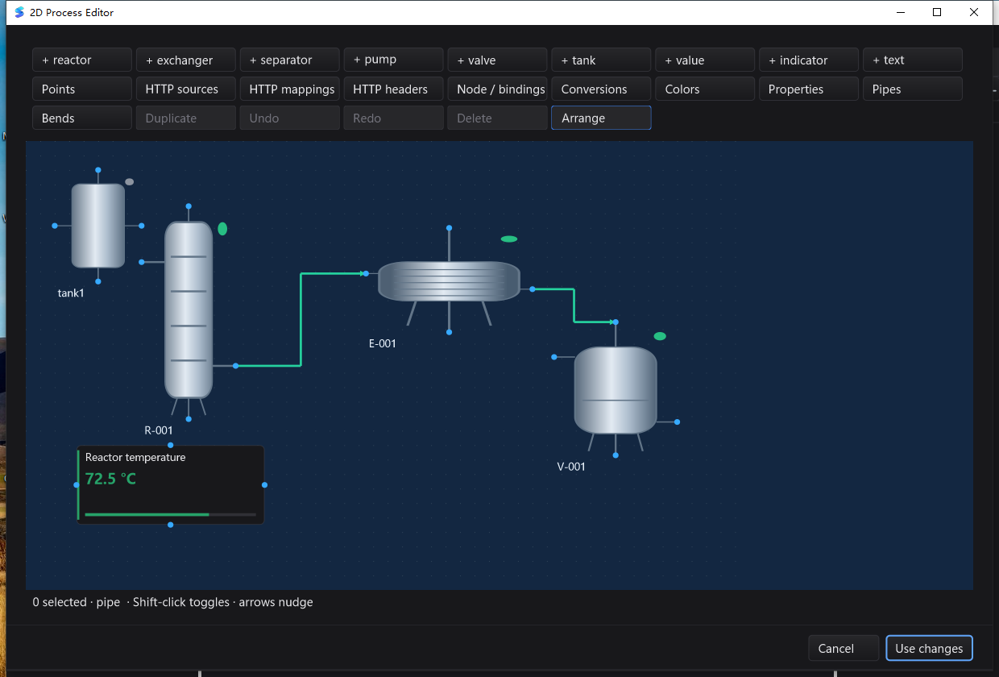
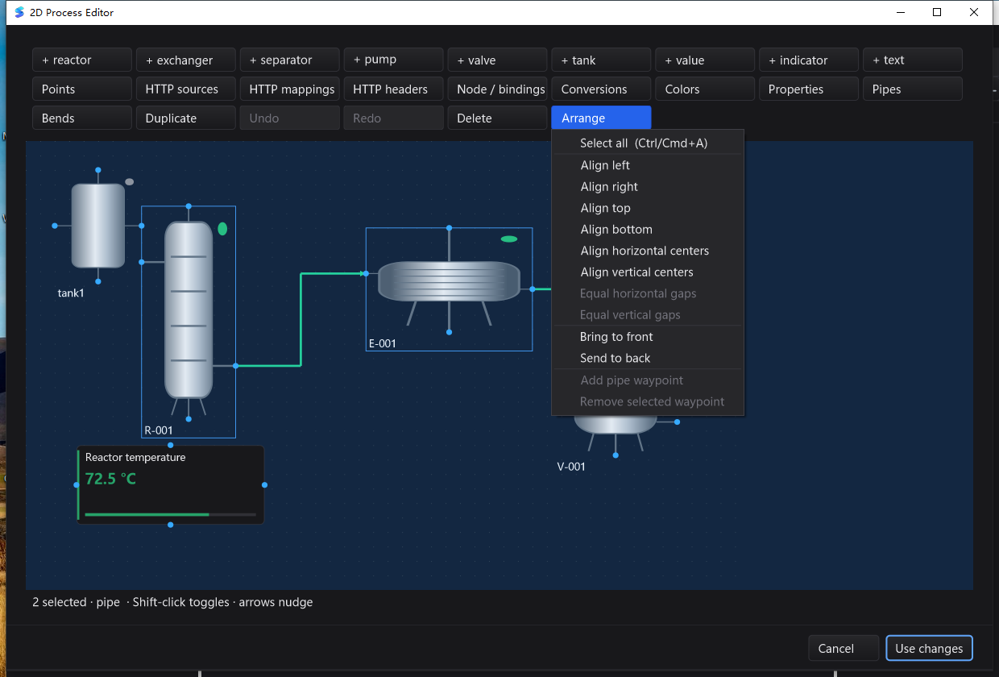
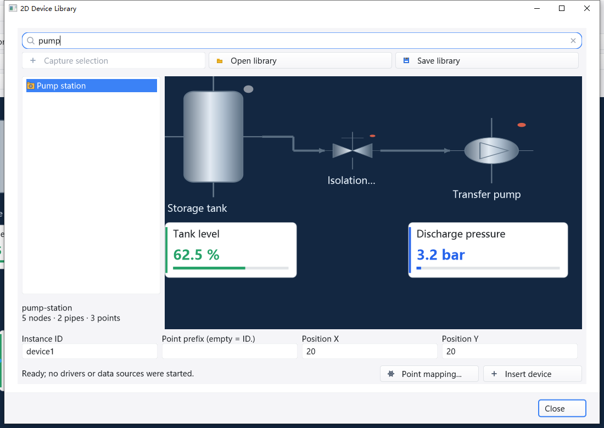
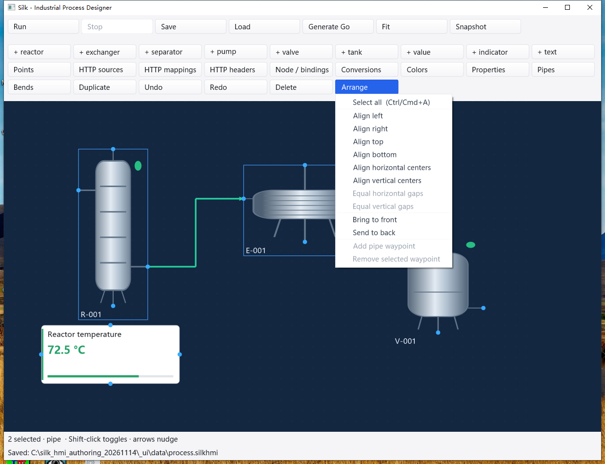
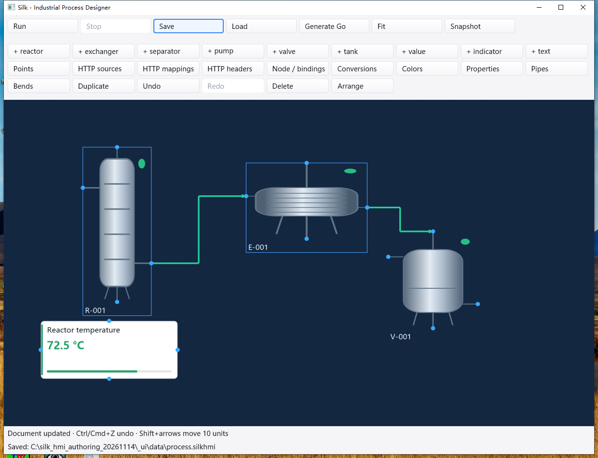
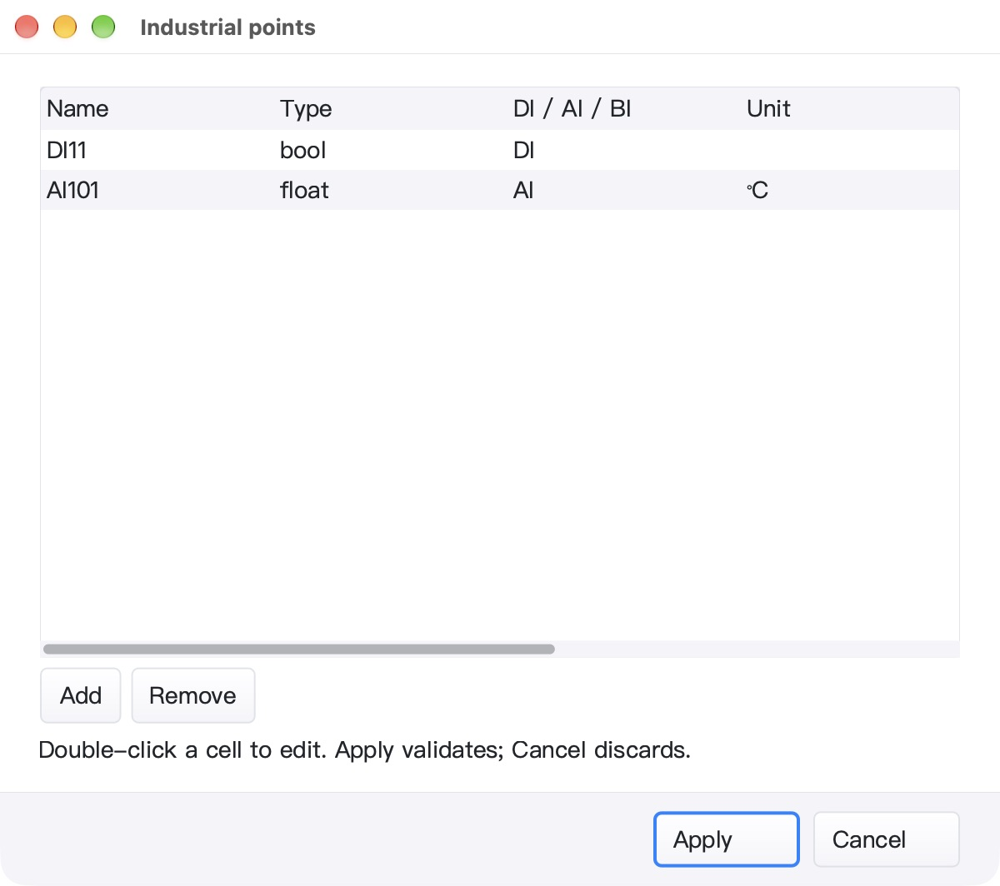

# Industrial 2D process workbench

Run `go run ./cmd/silkhmi`. The template is local and inert: opening a document,
painting, dragging and opening configuration tables never starts acquisition.
**Run** explicitly starts the point store and enabled source workers; **Stop**
cancels and joins them before authoring is unlocked. Closing also cancels/joins.



## Authoring workflow

1. Add reactor, exchanger, separator, pump, valve, tank, indicator, value or text
   nodes. Drag devices with 10-unit snapping; click two blue ports to connect.
   Pipes follow moved/rotated endpoints. Wheel zooms around the pointer; middle
   drag pans; Fit resets the camera. Undo/Redo retains at most 32 snapshots.
2. **Points**: name, scalar type (`bool`, `int`, `float`, `string`), independent
   DI/AI/BI category, unit, initial value, description and optional stale timeout.
3. **HTTP sources**: URL, method, polling interval, timeout, request body, enabled
   and explicit consent to repeat POST/PUT/PATCH/DELETE. Read-style POST APIs
   still require this consent. Use **HTTP headers** for non-secret headers.
4. **HTTP mappings**: source ID, destination point, JSON Pointer (e.g.
   `/data/temperature`), optional cast and arithmetic/comparison expression.
   Complex SDK pipelines are preserved in the advanced JSON column, which
   overrides the shorthand columns when nonempty.
5. Select a node, then **Conversions** for ordered type/expression steps,
   **Colors** for ordered condition/color/state-text rules, and **Properties**
   for dynamic visible/enabled/x/y/rotation bindings. **Node / bindings** edits
   labels, point names, units and bounds. Removing a node removes incident pipes.
6. **Pipes** edits endpoint ports and optional flow point; **Bends** edits ordered
   route waypoints. Click a pipe, then use **Arrange → Add pipe waypoint** and
   drag its square handle. Delete removes the selected waypoint first, otherwise
   the selected pipe. Routing is deterministic orthogonal doglegs, **not obstacle
   avoidance**. Automatic dogleg corners are not authored waypoints.
7. **Save / Load** use `.silkhmi` documents. Save replaces atomically; Load
   validates before replacing and resets undo history. **Generate Go** writes
   `<project>.go`, refuses overwrite, and generates an inert runnable workbench.
   Keep generated main programs in a separate application/project directory,
   not in the framework checkout's existing Go package.
   In SilkIDE, ProcessDiagram / ProcessEditor can also be dropped into `.silkui`,
   saved, previewed and generated like other widgets.

Tables use staged edits: double-click a cell; Enter/click away commits the cell;
Apply validates the complete candidate; invalid candidates remain open; Cancel
leaves the document unchanged. IDs identify rows independently of table sorting.

### SilkIDE source and visual coordination



Open a `.silkhmi` file in the ordinary IDE editor. It uses the JSON dialect,
including normal source navigation, instead of pretending to be Go source.
**Tools → Edit 2D Process...** (also in the command palette) opens an owned visual
editor over that exact buffer, including unsaved edits. Resize fitting keeps the
document within the modal viewport; nested point/binding tables remain staged.

**Use changes** publishes all visual edits as one normal source-buffer undo
transaction. It does not save the file. Ctrl/Cmd+S or Save All uses the ordinary
IDE save/dirty/recovery workflow; Cancel or closing the visual editor discards
its draft. An unchanged draft does not dirty the source. Late decode/commit
results are rejected if the source tab, path, revision or writable state changed.
Read-only/formatting documents and concurrent file operations disable/reject the
command. No independent shadow document or hidden file writer is introduced.

This modal is deliberately inert: it does not start SQL, HTTP or point workers.
Use the standalone workbench with `-project <saved-file>` for explicit Run/Stop.
Bidirectional node-to-JSON-caret selection and full runtime panels inside the IDE
remain later integration work.



See [IDE workflow/native verification](../HMI_IDE_QA_20261114.md) for source
identity, full test results, screenshots and remaining first-frame/platform
verification boundaries.

### Reusable device library



**Device library** opens an owned, inert preview with searchable pump-station,
heat-recovery and valve-station compositions. Choose an instance ID, point
prefix and document-space position, then **Insert device**. The entire subgraph
and its point definitions form one Undo step; failed validation changes nothing.

Default point names are independent for each instance. **Point mapping...**
explicitly reuses compatible existing points without replacing their definitions
or acquisition owners. Type/category/unit must match. **Capture selection**
copies selected nodes, internal pipes/bends and referenced definitions only:
HTTP sources, runtime samples and retention policies are never duplicated.

**Open library / Save library** explicitly load/store `.silkhmilibrary` files on
owned workers. Closing or locking the editor retires nested library dialogs;
cancelled or stale load callbacks cannot replace newer state. Preview never
starts acquisition. These are schematic templates, not certified P&ID symbols,
PLC drivers, or persistent linked prefab instances.

Catalogs are session-local in the standalone/IDE workbench until explicitly
saved; `.silkhmi` stores the placed content. The **Device library JSON** widget
property also round-trips through `.silkui`, preview and generated constructors.
See the [runnable SDK example and file-I/O limits](../examples/processlibrary/README.md).

### Direct manipulation



- Shift-click or Ctrl/Cmd-click toggles nodes. Drag from empty canvas left to
  right to select fully contained nodes; right to left includes intersecting
  nodes. Hold Shift/Ctrl/Cmd to add a box selection.
- Drag a selected device to move the whole selection without changing relative
  spacing. Internal pipe waypoints move too; external waypoints stay anchored.
  Boundary clamping uses one common delta. Shift constrains a move to an axis;
  Alt bypasses grid snapping.
- Select one device and drag a corner square to resize; Shift preserves aspect
  ratio. A gesture changes only the preview until release, then records one undo
  step. Escape, capture cancellation, resize/zoom/document replacement or closing
  discards the preview. Exported/saved state never contains an unfinished drag.
- **Arrange** provides six alignments, equal horizontal/vertical gaps (at least
  three nodes), front/back ordering and waypoint commands. Impossible equal-gap
  layouts report an error rather than creating negative gaps/overlap.
- Ctrl/Cmd+A selects all; Ctrl/Cmd+D duplicates the selected subgraph and its
  internal pipes; Ctrl/Cmd+Z / Shift+Z (or Y) undo/redo. Arrow keys nudge one unit,
  Shift+Arrow ten. Delete/Backspace removes selection. F or Ctrl/Cmd+0 fits.
  Duplicated devices deliberately keep their point bindings; they do not create
  a second acquisition source or silently rename industrial points.
- Editing displays authored positions, enabled state and visibility even when
  live bindings would move/hide a device. Run enables live properties and locks
  authoring. Save/Load/Generate also lock authoring while their worker owns I/O,
  without entering runtime preview. Unavailable commands are disabled.

The pure-Go editing SDK can be used independently of the GUI:

```go
candidate, err := hmi.MoveNodes(project, []string{"reactor", "exchanger"}, 40, 20)
// On success, candidate owns independent slices/maps; project is unchanged.
// Publish candidate on the UI thread if a ProcessDiagram is its consumer.
```



These are native desktop captures, not generated mockups. For the exact source
identity, platform test scope and remaining native-macOS capture limitation, see
[authoring QA](../HMI_AUTHORING_QA_20261114.md).

## Runtime, database and SDK

- `hmi.Project` is a portable validated model; Parse/JSON never starts services.
- `point/sqlite.Store` persists definitions and exact typed latest/history
  observations. A point observation commits latest + history together. The
  runtime restores stored samples (including time/quality), then applies TTL;
  HTTP-owned points start Uncertain until a fresh response arrives.
- `hmi.NewRuntime(ctx, project, store, headers)` explicitly prepares definitions;
  call on an owned worker because storage may block. Start launches one worker
  per source plus one shared watchdog; Stop cancels and joins them.
- `Runtime.Publish` converts/persists/notifies a manual/driver point. HTTP-owned
  points reject a second SDK writer. External drivers must cancel/join their own
  workers before closing the store. Direct SQL modifications are not polled as
  a live change feed; publish via the SDK/Tag bus instead.
- No timer or network worker per visual element. Source responses are parsed
  once and shared across point mappings. Tag UI updates are coalesced and read
  the authoritative latest sample, avoiding stale callback-order overwrites.
- Same values refresh acquisition time/history without repaint notification.
  Bad or Uncertain values are grey `—`, never fabricated valid zeros.
- Optional `retention_days` prunes at most 10,000 expired history rows per minute;
  latest/definitions remain. This is bounded housekeeping, not a hard disk quota
  or guaranteed retention under arbitrary sustained input rates; no VACUUM.

Example SDK write (after explicit runtime construction):

```go
err := runtime.Publish(ctx, "AI101", core.Value{
    Raw: "92.8", Quality: core.QualityGood, Time: time.Now(),
})
```

Credentials stay outside documents: supply `hmiapp.Config.RequestHeaders`, or
`SILK_HMI_HTTP_HEADERS='{"source-id":{"Authorization":["Bearer ..."]}}'` to the
CLI. Authorization/Cookie, URL userinfo and malformed headers are rejected in
saved source definitions. Do not put secrets in URL query strings or bodies.



## Safety, compatibility and limits

This is a **2D authoring/runtime foundation**, not a certified SCADA/DCS control
system, complete P&ID library, Qt Creator replacement or 3D editor. Equipment is
schematic vector art; there is no physical PLC write/control integration here.
A response may update valid fields alongside Bad fields: multi-point updates
are not an atomic PLC scan or a cross-point database transaction. Condition
rules are first-match, not an alarm lifecycle (no hysteresis, delay or ack).
Invalid dynamic-property samples retain the preceding visual property; do not
use visual enable/visibility as a safety interlock. Obstacle-aware piping,
equipment-template libraries, alarm lifecycles and deeper IDE source/runtime
coordination remain product gaps; this is not full IDE feature parity.

SQLite requires CGO. `point` conversion/expression/HTTP and `hmi` without a SQL
adapter work without CGO. `gui` does not import SQL/SQLite. Workbench binaries
still require the normal platform Cairo/GLFW (or Win32) runtime dependencies.
See [point SDK](../point/README.md) and the release QA report for the exact tested
platforms and the distinction between automated and native UI coverage.
