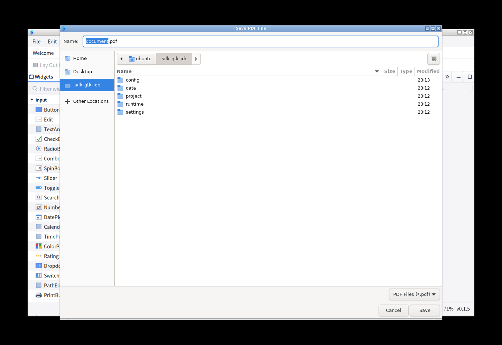
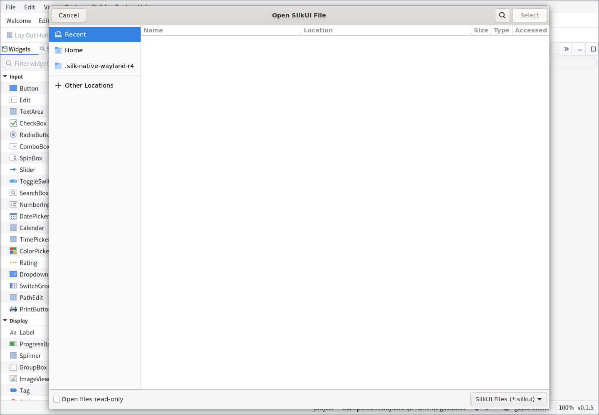
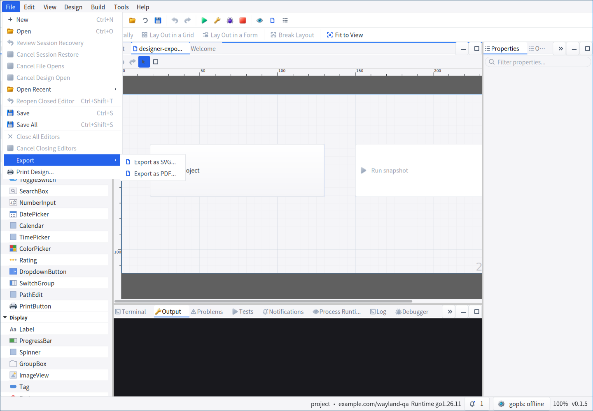

# Linux/X11 native file chooser

SilkIDE prefers the desktop FileChooser portal when a visible X11 owner and the
session service are available. A minimal desktop still uses Zenity if the
portal request cannot start. Canceling the portal does not open another picker.

This is an original capture of a source-built workbench in an isolated Ubuntu
24.04 ARM64 desktop. Tests used xdg-desktop-portal 1.18.4 and the GTK backend
1.15.1. For both PDF and SVG the GTK window's X11 transient owner matched
the exact Designer window, and both panels selected the intended format
and offered the correct default filename.

- Canceling export wrote no file. Saving the untouched defaults produced
  `document.pdf` and `document.svg`; independent readers confirmed a
  280 × 115 mm page and the authored positions of both button rasters.
- The original design's hash did not change. The IDE closed normally.
- A separate native SDK probe checked acceptance, cancellation and removal
  of the owner while its picker was showing. Protocol tests separately
  checked that cancellation requested from the application closes the
  owning D-Bus request.

The original tested code archive is
`49bb813dffdc22a35d353d4d3ef7dcfe071706be10422f6a5a58bf5dcebda8f6`.
Adding this record and its image made no runtime changes. Native Wayland
foreign-surface export is not covered by this verification.

## Native Wayland open and cancel

The source-built Designer ran in an isolated ARM64 Sway 1.9 session with
XWayland disabled (`go build -tags wayland ./cmd/silkide`). Cairo/GLFW rendered
the first frame without waiting for a resize callback to initialize the widget.
The compositor traces showed two distinct owner handles from the same Designer
surface, imported by the actual GTK chooser. Cancel restored the identical
Designer frame. Selecting a second design reopened it and changed the window
title; neither design file was rewritten, and the application closed normally.

The first-frame regression probe passed on Wayland and X11. In the same
Wayland environment it failed when only the earlier scheduler was restored.
The verified runtime source archive was
`12bc88bd61c2c9b4853112a3fb72ce20ac6b20f4efa79cec7b983bc628671cbf`.
This records file-opening/cancellation and first rendering. It does not
certify Wayland export, native menu positioning, other compositors, or general
Wayland parity.

## Native Wayland menus and export

A separate source-built Sway 1.9 session with XWayland disabled exercised
`File → Export` in the real workbench. Both menus rendered in the same
compositor surface. Each export opened the GTK chooser with the matching
filter and default suffix and with its parent bound to that same form.
Canceling the first SVG save wrote nothing. Confirming the PDF and a second
SVG save created one file per format and preserved the 280 × 115 mm page and
both authored raster locations. Clicking outside the menu dismissed it and
activated Fit to View. Closing the IDE while its menu was open was normal;
the original fixture was unchanged.

A Cairo pixel test also rejects an invisible submenu outside the origin:
the host-coordinate clip must be installed before translating the painter.
The runtime archive for this independent test was `16ae7d926dca2e841c87026eb769ca0fa2445382028af6a83f496b3a8374874d`.
Other compositors, individual popup widget families and full keyboard
interaction are outside this specific integration test.
