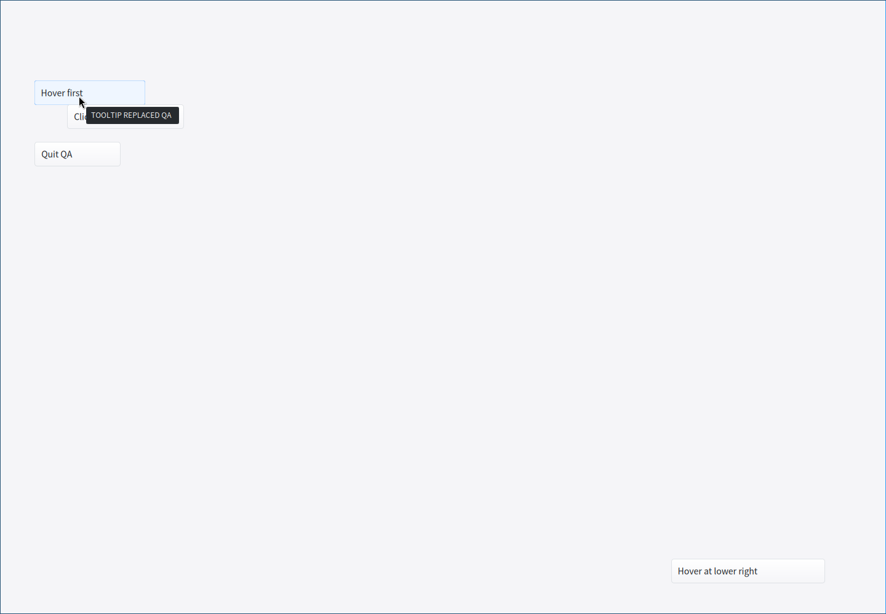

# Passive control tooltips

Use `gui.SetToolTip(widget, "Explain this action")` for normal hover
feedback. The nearest registration within the current window wins. Use an
empty string to clear the hint. Registration can be updated from a worker:
visible text refreshes on the UI thread. No extra native window, layout
child, click target or per-tooltip repeating timer is created.
Programmatic `ShowToolTipFor` (e.g. editor LSP documentation) retains its
existing explicit-anchor behavior.



The capture is from a source-built Linux ARM64 SDK probe in an isolated
native Sway session with XWayland disabled. The actual pointer showed a
hint; changing the registration from a worker updated it while the pointer
remained over the control. The underlying button received its click and
removal of the registration erased the old hint. A second tooltip stayed
inside the right client edge and disappeared on pointer leave. The process
closed normally. A compositor trace recorded only one application surface
for the entire probe and no popup surface.

Regressions can be run with:

```sh
go test -race ./gui -run '^TestRegisteredToolTip'
# Native Wayland build (Linux with supported GLFW dependencies)
go test -race -tags wayland ./gui -run '^Test(RegisteredToolTip|GLFWClientPopup)'
```

The cases check ancestor fallback and independent window boundaries,
placement at the lower edge, damage clipping, pass-through hit testing
and owner lifecycle. The native capture does not certify all compositors
or Windows/macOS desktop interaction.
